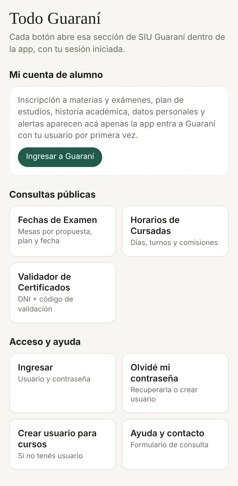

# Guaraní al día

[](https://github.com/parizeliseo/SIU-GUARANI-PUBLICO/actions/workflows/compilar.yml)

Aplicación Android **libre y gratuita** para estudiantes de cualquier universidad o instituto que
use **SIU Guaraní**. Trae tu Guaraní completo adentro de la app, lo revisa sola cada cierto tiempo
y te avisa al celular cuando se carga una nota, se abre una inscripción o cambia cualquier cosa.

- Funciona con **cualquier SIU Guaraní 3 (autogestión)**: elegís tu institución de la lista o
  pegás la dirección de la tuya.
- **Varias cuentas**: una por facultad o institución, o más de un usuario en la misma. La app las
  revisa a todas.
- La contraseña se puede **guardar en el teléfono, cifrada**, o no guardarse nunca.
- Entra tanto con el formulario propio de Guaraní como con el **usuario institucional** (ingreso
  único SAML/CAS, como en UTN-FRBA o UNQ).
- **Sonido propio** cuando cargan una calificación, con botón para **compartirla**.
- **Exámenes con recordatorios** (una semana antes, el día anterior y el mismo día) y botón para
  pasarlos a **Google Calendar**.
- Los **PDF oficiales** de Guaraní (historia académica, plan, comprobantes), tal como los emite el
  sitio, listos para abrir o compartir.
- Institución y **carrera seleccionada** siempre a la vista, en todas las pantallas.

> No es una aplicación oficial del SIU ni de ninguna institución. La hizo un estudiante, y el
> código está abierto para que cualquiera lo revise.

## Descargar

| Archivo | Qué es |
|---|---|
| [`publicado/Guarani-al-dia-1.4.2.apk`](publicado/Guarani-al-dia-1.4.2.apk) | La aplicación, lista para instalar (Android 8.0 o más nuevo). |
| [`publicado/Manual-Guarani-al-dia.pdf`](publicado/Manual-Guarani-al-dia.pdf) | **Manual de uso completo** (22 páginas, con capturas): instalación, cuentas, avisos, exámenes y calendario, PDF, sesión, ajustes y problemas frecuentes. También se puede [leer en línea](docs/manual/MANUAL.md). |

Descargá el `.apk` en el celular, abrilo desde *Archivos* y permití la instalación desde esta
fuente. No está en Google Play. Cada versión se firma con la misma clave, así que se instala encima
de la anterior y conserva tus cuentas, datos y ajustes.

### Comprobar que el APK es el original

Cada versión se firma con la misma clave, que no está en este repositorio. Antes de instalar podés
comprobar que el archivo no fue modificado:

| Dato | Valor |
|---|---|
| Paquete | `ar.pariz.guarani` |
| Huella SHA-256 del certificado de firma | `16:1D:A6:D1:3E:D4:D2:22:A5:DB:7E:7E:C8:6C:C1:1B:E3:9B:2E:41:CA:24:14:46:FA:3E:B1:72:D2:C2:54:AD` |
| SHA-256 de `Guarani-al-dia-1.4.2.apk` | `7e5650b96d27b3ee0d090ca41aa1be44b2d64a41a0a6ed9a4f63a6a2f649a149` |

- **En una computadora:** `sha256sum Guarani-al-dia-1.4.2.apk` (Linux/macOS) o
  `Get-FileHash Guarani-al-dia-1.4.2.apk` (Windows) tiene que dar el valor de la tabla. Con las
  herramientas de Android, `apksigner verify --print-certs` muestra la huella del certificado.
- **En el teléfono:** si ya tenés instalada una versión anterior, Android **solo acepta la
  actualización si la firma coincide**. Un APK alterado no se instala encima.
- Las sumas de cada versión también están en las [publicaciones (Releases)](https://github.com/parizeliseo/SIU-GUARANI-PUBLICO/releases).

## Seguridad

Lo que la app hace para cuidar tu cuenta, y que cualquiera puede revisar en el código:

- **Solo conexiones cifradas (https).** El tráfico sin cifrar está bloqueado en toda la app, y solo
  se aceptan certificados de las autoridades del sistema: un certificado instalado a mano no alcanza
  para espiar la conexión. Si una dirección de Guaraní no usa https, la app no la acepta.
- **La contraseña se escribe solo donde corresponde:** en páginas https de tu institución, o en la
  página de ingreso único a la que Guaraní redirige en ese momento. Nunca en otra página que abras
  después.
- **Contraseña cifrada** con el Android Keystore del teléfono. Sin copias de seguridad en la nube.
- **Otras apps no la pueden manejar.** Los botones de las notificaciones (Compartir, Agendar) llevan
  una clave aleatoria de tu instalación; si otra app intenta abrirla con datos propios, se ignoran.
- Los visores internos **no pueden leer archivos del teléfono**, tienen *Navegación segura* de Google
  activada y no cargan contenido mixto. Desde Guaraní solo se abren afuera enlaces de correo,
  teléfono, SMS y mapas.
- **Permisos mínimos:** internet, notificaciones, arrancar al encender el teléfono, trabajar en
  segundo plano. No pide ubicación, contactos, calendario, cámara, micrófono ni archivos.
- **Sin publicidad, sin estadísticas, sin servidores propios.** La app habla solo con el Guaraní de
  cada cuenta.
- Firma v2 + v3 (esquemas modernos de Android), versión de destino Android 15 (API 35), sin modo de
  depuración.

**Sobre el aviso de Play Protect.** Como la app no viene de Google Play, Android puede mostrar
*«App no reconocida»* o *«Desarrollador desconocido»*. No significa que se haya encontrado algo malo:
es lo que muestra con cualquier app instalada desde fuera de la tienda. Tocá **Más detalles →
Instalar de todas formas**. Google está implementando la verificación obligatoria de desarrolladores
para apps de fuera de la tienda (desde septiembre de 2026 en Brasil, Indonesia, Singapur y
Tailandia; en el resto del mundo, desde 2027). En Argentina todavía no rige; cuando llegue, el
estado del registro de esta app va a figurar acá.

## Primeros pasos

1. Abrí la app y tocá **Agregar mi cuenta**.
2. En **Institución o facultad** escribí parte del nombre (por ejemplo *UTN*, *UNC* o *IUGNA*) y
   elegila. Si la tuya no aparece, pegá en **Dirección** la dirección de tu Guaraní: la que ves en
   el navegador cuando entrás a autogestión (por ejemplo `https://…/autogestion/`).
3. Poné tu **usuario** (DNI, legajo o e-mail, según tu institución) y tu **contraseña**.
4. Elegí si querés **guardar la contraseña en el teléfono** y tocá **Agregar cuenta y revisar**.
5. Aceptá las notificaciones y, en Ajustes, tocá **Permitir que funcione en segundo plano**, para
   que el ahorro de batería no frene las revisiones.

Para sumar otra facultad o institución, tocá **+ Nueva** en Ajustes (o **+ Cuenta** en el
tablero). Con dos o más cuentas aparece arriba del tablero un selector para pasar de una a otra.

La primera revisión de cada cuenta **no avisa nada**: toma una foto de cómo está tu Guaraní hoy.
Desde la segunda, avisa todo lo que cambie.

## ¿Guardar o no la contraseña?

| | Con la contraseña guardada | Sin guardarla |
|---|---|---|
| Revisión en segundo plano | Siempre: si la sesión vence, la app vuelve a entrar sola. | Mientras dure la sesión que abriste en la pestaña Guaraní. Cuando vence, te avisa que hay que volver a entrar. |
| Dónde queda | Cifrada en el teléfono con el **Android Keystore**. Nunca sale del teléfono, salvo hacia la dirección de Guaraní de esa cuenta (o hacia el ingreso único al que Guaraní te manda). | En ningún lado. |

También podés decidirlo después: si entrás a mano desde la pestaña **Guaraní**, la app te pregunta
si querés guardar la contraseña (*Guardar*, *Ahora no* o *Nunca para esta cuenta*). Las copias de
seguridad de Android están desactivadas para la app, así que la contraseña no viaja a la nube. Para
borrarla, destildá la opción en la cuenta o borrá la cuenta.

## Instituciones incluidas

Estas direcciones se comprobaron una por una contra el sitio real (12 de noviembre de 2026): todas
responden como SIU Guaraní autogestión para alumnos.

| Institución | Dirección |
|---|---|
| IUGNA — Instituto Universitario de Gendarmería Nacional | `https://siu.iugna.edu.ar/autogestion/` |
| UNC — Universidad Nacional de Córdoba | `https://autogestion.guarani.unc.edu.ar/` |
| UNLP — Universidad Nacional de La Plata | `https://autogestion.guarani.unlp.edu.ar/` |
| UNR — Universidad Nacional de Rosario | `https://autogestion-guarani.unr.edu.ar/` |
| UNT — Universidad Nacional de Tucumán | `https://guarani.unt.edu.ar/autogestion/` |
| UNSJ — Universidad Nacional de San Juan | `https://autogestion.guarani.unsj.edu.ar/` |
| UNSE — Universidad Nacional de Santiago del Estero | `https://autogestion.guarani.unse.edu.ar/unse/` |
| UNJu — Universidad Nacional de Jujuy | `https://alumnos.unju.edu.ar/unju/` |
| UNRN — Universidad Nacional de Río Negro | `https://guarani.unrn.edu.ar/g3w3/` |
| UNQ — Universidad Nacional de Quilmes | `https://autogestion.uvq.edu.ar/unq/` |
| UNVM — Universidad Nacional de Villa María | `https://autogestiong3.unvm.edu.ar/unvm/` |
| UNTREF — Universidad Nacional de Tres de Febrero | `https://autogestion.untref.edu.ar/` |
| UNAJ — Universidad Nacional Arturo Jauretche | `https://guarani.unaj.edu.ar/autogestion/` |
| UNCA — Universidad Nacional de Catamarca | `https://guarani.unca.edu.ar/autogestion/` |
| UNaF — Universidad Nacional de Formosa | `https://guarani.unf.edu.ar/autogestion/` |
| UNIPE — Universidad Pedagógica Nacional | `https://guarani.unipe.edu.ar/autogestion/` |
| UNRaf — Universidad Nacional de Rafaela | `https://guarani.unraf.edu.ar/autogestion/` |
| UNDEF — Instituto Universitario Aeronáutico (IUA) | `https://autogestion.iua.edu.ar/` |
| UNDEF — Facultad de Ingeniería del Ejército (FIE) | `https://www.fie.undef.edu.ar/siu/3w/` |
| IUSE — Instituto Universitario de Seguridad | `https://autogestion.iuse.edu.ar/` |
| UBA — Ciclo Básico Común (CBC) | `https://guarani.uba.ar/cbc/` |
| UBA — Facultad de Agronomía | `https://guarani.agro.uba.ar/agro/` |
| UBA — Facultad de Farmacia y Bioquímica | `https://guarani.ffyb.uba.ar/ffyb/` |
| UBA — Facultad de Ciencias Veterinarias | `https://guarani.fvet.uba.ar/veterinaria/` |
| UTN — Facultad Regional Buenos Aires (grado) | `https://guarani.frba.utn.edu.ar/autogestion/grado/` |
| UTN — Facultad Regional Concepción del Uruguay | `https://guarani.frcu.utn.edu.ar/autogestion/` |
| IUPA — Instituto Universitario Patagónico de las Artes | `https://guarani.iupa.edu.ar/autogestion/` |

**¿Tu institución no está?** Igual funciona: pegá la dirección en la cuenta. Y si querés que
aparezca en la lista para todos, [pedila acá](https://github.com/parizeliseo/SIU-GUARANI-PUBLICO/issues/new?template=nueva-institucion.yml)
o agregala vos en
[`instituciones.json`](app-android/app/src/main/assets/instituciones.json) con un *pull request*.

Algunas direcciones que suelen circular **no sirven para esta app**:

- Las que muestran **«Guaraní – Autentificación de Usuarios»** son el Guaraní de *gestión*, el que
  usa el personal administrativo, no la autogestión de alumnos.
- Las que funcionan sin `https` (solo `http`): Android bloquea esas conexiones por seguridad.
- Las direcciones armadas "por fórmula" (`guarani.` + la sigla de la universidad): la mayoría no
  existe. Cada institución publica su Guaraní donde quiere; la dirección buena es la que te da tu
  facultad.

## Qué tiene

**Cuatro pestañas** (todas siguen a la cuenta elegida):

- **Tablero:** arriba, la **institución** y la **carrera** con letras grandes, y si la sesión está
  abierta. Debajo: avance de la carrera, promedio, aprobadas, finales pendientes y materias en
  curso; **próximos exámenes** con botón *Agendar*; finales pendientes; novedades; **todas las
  materias del plan** con estado y nota, buscador y filtros; y los **documentos oficiales** en
  PDF. Se actualiza sola al abrir la app; deslizá hacia abajo para actualizar en el momento.
- **Menú:** todas las secciones de tu Guaraní en botones. *Mi cuenta de alumno* sale del menú real
  de tu institución después de entrar (inscripción a materias y exámenes, plan, historia
  académica, datos personales, mensajes…). *Consultas públicas* y *Acceso y ayuda* salen de la
  portada de tu institución (fechas de examen, horarios, validador de certificados, recuperar
  contraseña…).
- **Guaraní:** el sitio completo dentro de la app, con ingreso automático. Se puede hacer todo lo
  que hace la web: inscribirse, descargar certificados (van a *Descargas* y se pueden abrir o
  compartir al terminar) y subir archivos. El botón ⤓ guarda la pantalla como PDF.
- **Ajustes:** cuentas, frecuencia de revisión, avisos y páginas que se vigilan.

**Avisos por tema.** Cada tema tiene su canal, que se puede silenciar aparte desde Android. Con
varias cuentas, cada aviso empieza con el nombre de la cuenta.

| Canal | Cuándo llega | Ejemplo de título |
|---|---|---|
| Calificaciones nuevas (**con sonido propio**) | Se carga o cambia una calificación, una promoción, una regularidad o un acta, incluidas las provisorias. Botón *Compartir*. | *«Nueva calificación en Guaraní — Física I: examen aprobado con 8.»* |
| Inscripciones y mesas de examen | Aparece una fecha de examen o evaluación (botón *Agendar*), se abre o cierra una inscripción, o aparece una mesa. | *«Nueva fecha de examen»*, *«Se abrió la inscripción a exámenes»* |
| Recordatorios de examen | Una semana antes, el día anterior y el mismo día, entre las 8 y las 22. Botón *Agendar*. | *«Mañana: Examen: Algoritmos y Estructuras de Datos»* |
| Plan de estudios | Cambia algo en el plan de tu propuesta. | *«Cambió tu plan de estudios»* |
| Mensajes y encuestas | Llega un mensaje de la institución o hay una encuesta pendiente. | *«Mensaje nuevo en Guaraní»* |
| Otros cambios en Guaraní | Cualquier otra cosa que cambie (se puede apagar en Ajustes). | *«Cambió algo en Datos personales»* |
| Estado de la sesión | Guaraní no deja entrar (contraseña cambiada, sesión vencida sin contraseña guardada, captcha). Avisa una sola vez. | *«Guaraní: hay que volver a entrar»* |

Los temas de interés se avisan **siempre**; el interruptor de Ajustes solo apaga «Otros cambios».

**Google Calendar.** *Agendar* abre tu app de calendario (Google Calendar u otra) con el examen
cargado: título, día, hora, llamado, mesa y lugar. Vos confirmás; la app no pide permiso para leer
ni escribir tu calendario.

**Compartir.** *Compartir notas* manda un resumen en texto (carrera, promedio y materias por
estado) por WhatsApp, mail o cualquier app. Para un documento con valor oficial, usá el PDF de la
historia académica.

## La sesión, siempre abierta

Para avisarte, la app necesita tener abierta tu sesión de Guaraní. La mantiene así:

1. **Cada 8 minutos toca Guaraní** con un pedido liviano, para que la sesión no venza por falta
   de uso (*Ajustes → Mantener la sesión abierta*, activado de fábrica).
2. **Si igual vence** (Guaraní se reinició, pasó la noche sin red…) y la contraseña está guardada,
   vuelve a entrar sola en el momento. Sin contraseña guardada, te avisa una vez para que entres.
3. **Vigilancia permanente** (opcional): deja una notificación fija que impide que Android cierre
   la app. Activala si los avisos te llegan tarde; algunos teléfonos (Xiaomi, Samsung, Motorola
   con ahorro agresivo) frenan las apps en segundo plano.

Conviene además tocar *Permitir que funcione en segundo plano*. Los avisos no son instantáneos:
llegan en la revisión siguiente al cambio (cada 15 minutos a 6 horas, según elijas). Con el
teléfono apagado o sin red no hay revisión; al volver, la app se pone al día y avisa lo acumulado.



## Cómo funciona por dentro

- La revisión corre con **WorkManager**: sigue andando con la app cerrada y después de reiniciar el
  teléfono. Revisa las cuentas una detrás de otra, cada 15 minutos a 6 horas.
- Abre Guaraní en un navegador interno invisible que **comparte las cookies** con la pestaña
  Guaraní. Si la sesión venció, completa el formulario de ingreso igual que una persona; si la
  institución usa ingreso único, toca *Acceder* y completa la página de ingreso de la institución.
- Si dos cuentas son del mismo Guaraní, la app **cierra la sesión de una antes de abrir la otra**,
  para no mezclar datos.
- Recorre las páginas del menú del alumno (hasta 30 por cuenta), guarda el texto de cada una y lo
  compara con la revisión anterior, línea por línea. Lo que aparece o desaparece es la novedad.
- Lee los reportes **completos**: en la historia académica pide *Historia completa* y en el plan de
  estudio toca *Expandir* (son los únicos clics que hace, y solo muestran información). Entiende el
  formato oficial de SIU Guaraní 3: el plan («8,0 (Promocionado) · Promoción»), la historia
  («Examen - 8 (Ocho) Aprobado 20/02/2026»), la actuación provisoria y *Mis inscripciones* (fechas
  de examen). Con eso arma la lista de materias, las notas, el promedio, el avance y los exámenes.
- Cada calificación se avisa **una sola vez** aunque aparezca en varias páginas; la primera lectura
  no avisa nada (son las notas que ya tenías).
- Lee la **carrera elegida** del dato *Propuesta* del plan o del selector de Guaraní.
- Anota los botones de PDF de cada página; al tocarlos, el archivo se pide a Guaraní con tu sesión
  y se guarda sin modificar.
- Nada pasa por servidores propios ni de terceros: la app habla solo con el Guaraní de cada cuenta.

**Límites conocidos:** si Guaraní pide captcha al entrar, hay que hacerlo a mano una vez desde la
pestaña Guaraní. Fechas de Examen y Horarios de Cursadas son buscadores con filtros: se usan desde
el Menú, pero la app no los revisa sola (tus mesas sí, desde tu cuenta). Si tu carrera y otra
propuesta se eligen con un selector dentro de Guaraní, se sigue la que esté seleccionada; para
seguir las dos, creá una cuenta por carrera. Cada institución configura Guaraní a su manera: si en
la tuya el tablero no muestra algo, los avisos de cambios siguen funcionando.

## Código

| Ruta | Qué es |
|---|---|
| `app-android/app/src/main/java/ar/pariz/guarani/MainActivity.kt` | Las cuatro pestañas, cuentas, descargas, subida de archivos, ingreso automático y la oferta de guardar la contraseña. |
| `…/Profiles.kt` | Las cuentas: institución, dirección, usuario y contraseña cifrada; sesiones separadas por cuenta. |
| `…/Instituciones.kt` + `assets/instituciones.json` | La lista de instituciones. |
| `…/Scraper.kt` | Navegador invisible: entra (formulario propio o ingreso único), lee los menús y recorre las páginas. |
| `…/Lector.kt` | Interpreta los reportes oficiales de Guaraní 3: plan, historia académica, actuación provisoria, inscripciones y carrera. |
| `…/Analyzer.kt` | Compara con la revisión anterior, arma materias, exámenes y documentos, y decide qué avisar. |
| `…/Compartir.kt` | Texto para compartir calificaciones y alta de eventos en el calendario del teléfono. |
| `…/CheckWorker.kt`, `Scheduler.kt` | Revisión periódica de todas las cuentas. |
| `…/KeepAliveWorker.kt`, `WatchService.kt` | Sesión siempre abierta: toque cada 8 minutos y vigilancia permanente opcional. |
| `…/Notifier.kt` | Los canales de notificación por tema, con el sonido de las calificaciones (`res/raw/calificacion.ogg`). |
| `…/Store.kt`, `Config.kt` | Datos de cada cuenta, fotos de cada página y ajustes generales. |
| `app-android/app/src/main/assets/dashboard.html`, `menu.html` | El tablero y la pestaña Menú. |
| `docs/manual/` | El manual: texto (`MANUAL.md`), capturas (`capturas.js`) y generador del PDF (`generar.py`). |
| `app-android/app/src/test/` | 29 pruebas: lectura de cada reporte (`LectorTest`), recorrido completo con avisos, sonido, recordatorios y datos de versiones anteriores (`FlujoTest`), pantallas, calendario y compartir (`PantallaTest`), y avisos por tema (`AnalyzerTest`). |
| `app-android/app/src/test/guarani/` | Páginas de prueba armadas según la documentación del SIU, y `probar.js`, que les corre el mismo JavaScript que la app usa dentro de Guaraní. |

Paquete `ar.pariz.guarani`, minSdk 26, targetSdk 35, Kotlin 2.0, Android Gradle Plugin 8.7.

### Compilar

```bash
cd app-android
./gradlew testReleaseUnitTest assembleRelease
```

Necesita JDK 17 o más nuevo y el SDK de Android (API 35). Sin clave queda un APK sin firmar. Para
firmarlo, poné `guarani.keystore` y un `keystore.properties` en `app-android/app/`:

```properties
storePassword=…
keyAlias=guarani
keyPassword=…
```

**La clave de firma no se sube nunca al repositorio** (está en el `.gitignore`). Si se pierde, las
versiones nuevas ya no se pueden instalar encima de las viejas.

## Licencia

GNU GPL v3 (ver [`LICENSE`](LICENSE)). Podés usarla, estudiarla, modificarla y compartirla; si
publicás una versión modificada, tiene que seguir siendo libre y con el código abierto.

Qué cambió en cada versión: [`CHANGELOG.md`](CHANGELOG.md).
