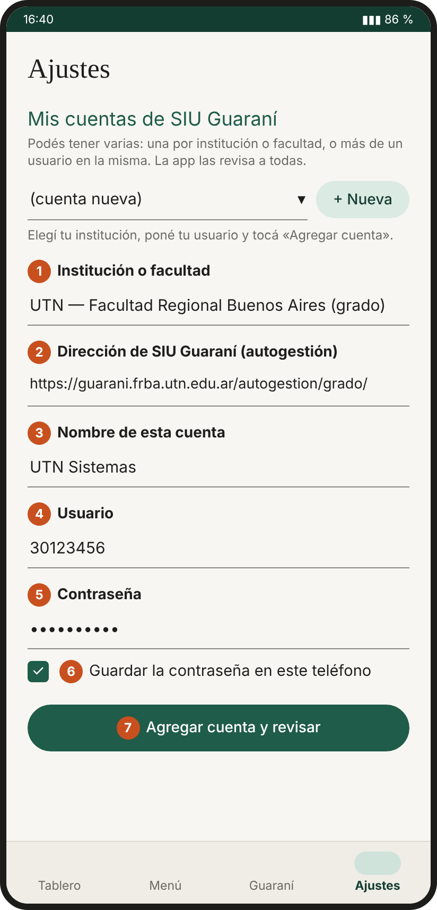
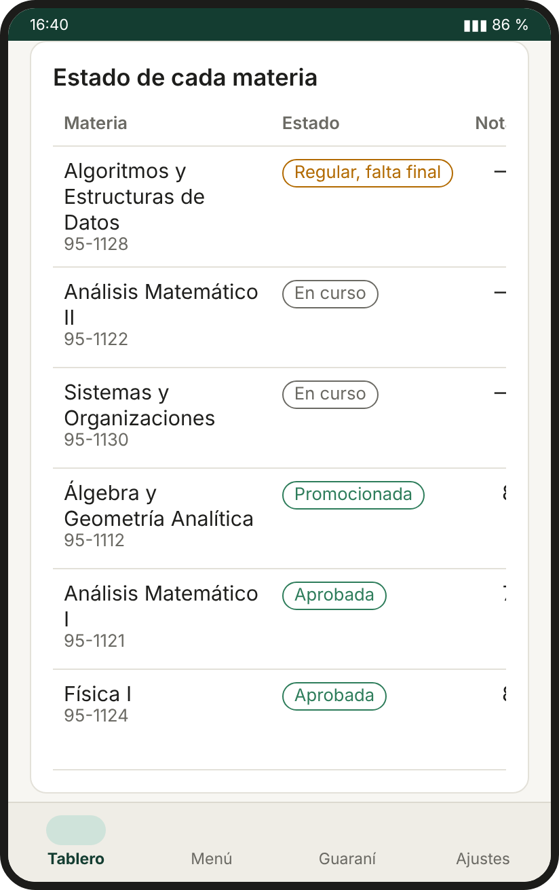
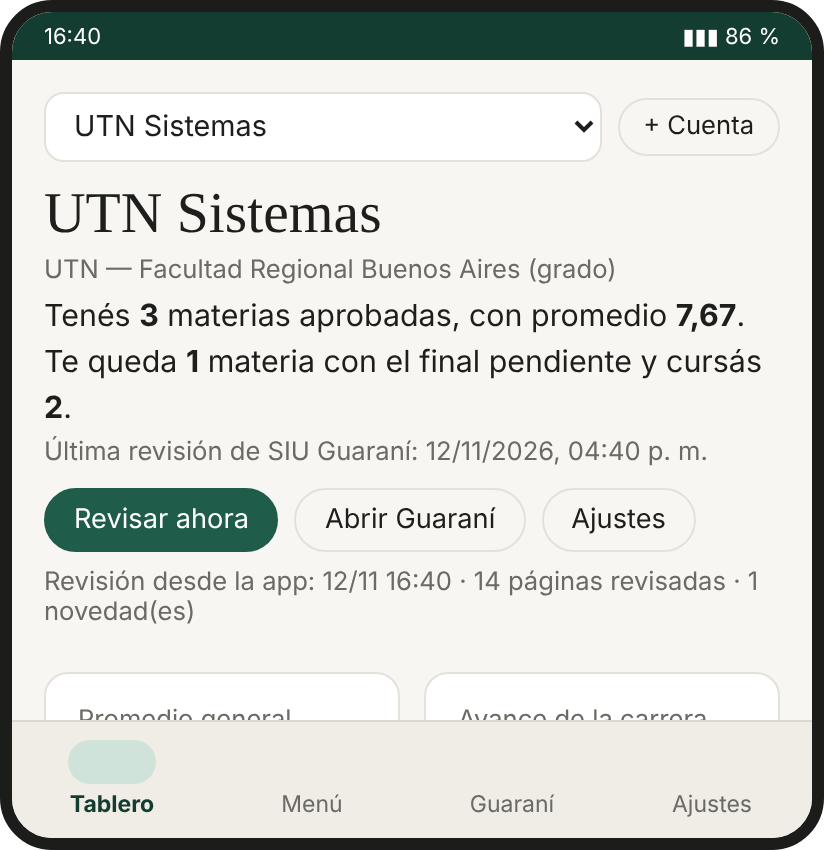

# Guaraní al día — Manual de uso

**Versión 1.3.2 · noviembre de 2026**

Guaraní al día es una aplicación para Android, libre y gratuita, para estudiantes de cualquier
universidad o instituto que use **SIU Guaraní**. Trae tu Guaraní completo adentro de la app, lo
revisa sola cada cierto tiempo y te avisa al celular cuando cargan una nota, se abre una
inscripción o cambia algo.

> No es una aplicación oficial del SIU ni de ninguna institución. La hizo un estudiante y el
> código está abierto en [github.com/parizeliseo/SIU-GUARANI-PUBLICO](https://github.com/parizeliseo/SIU-GUARANI-PUBLICO).

## Contenido

1. [Qué hace y qué no hace](#1-qué-hace-y-qué-no-hace)
2. [Qué necesitás](#2-qué-necesitás)
3. [Instalar la app](#3-instalar-la-app)
4. [Agregar tu cuenta](#4-agregar-tu-cuenta)
5. [La primera revisión](#5-la-primera-revisión)
6. [Las cuatro pestañas](#6-las-cuatro-pestañas)
7. [Los avisos](#7-los-avisos)
8. [La sesión, siempre abierta](#8-la-sesión-siempre-abierta)
9. [Varias cuentas](#9-varias-cuentas)
10. [Tu contraseña y tu privacidad](#10-tu-contraseña-y-tu-privacidad)
11. [Si tu institución no está en la lista](#11-si-tu-institución-no-está-en-la-lista)
12. [Ajustes, uno por uno](#12-ajustes-uno-por-uno)
13. [Problemas frecuentes](#13-problemas-frecuentes)
14. [Límites conocidos](#14-límites-conocidos)
15. [Actualizar y desinstalar](#15-actualizar-y-desinstalar)
16. [Ayuda](#16-ayuda)

## 1. Qué hace y qué no hace

**Lo que hace:**

- Te muestra un **tablero** con tu promedio, tu avance y el estado de cada materia.
- Te **avisa** con una notificación cuando hay una calificación nueva, un cambio en el plan de
  estudios, una inscripción que se abre, una mesa de examen nueva, un mensaje o una encuesta.
- Te deja usar **Guaraní completo** sin salir de la app: inscribirte, pedir certificados, subir
  documentación.
- Mantiene tu **sesión abierta** para que los avisos no se corten.
- Maneja **varias cuentas**: una por facultad o institución.

**Lo que no hace:**

- No se inscribe a nada por vos ni cambia nada en Guaraní: solo mira. Lo que hagas en la pestaña
  Guaraní lo hacés vos, igual que en el navegador.
- No avisa al instante. Revisa cada cierto tiempo (cada 15 minutos como mínimo), así que el aviso
  llega en la revisión siguiente al cambio.
- No manda tus datos a ningún servidor propio ni de terceros. La app habla únicamente con el
  Guaraní de tu institución.

## 2. Qué necesitás

- Un teléfono con **Android 8.0 o más nuevo**.
- Tu **usuario y contraseña** de SIU Guaraní (autogestión de alumnos).
- Conexión a internet, por datos o por Wi-Fi.
- Que tu institución use **SIU Guaraní 3**. Si en el navegador la pantalla de ingreso dice
  «SIU Guaraní», sirve.

## 3. Instalar la app

La app no está en Google Play: se descarga desde GitHub.

1. Desde el celular, entrá a
   [github.com/parizeliseo/SIU-GUARANI-PUBLICO](https://github.com/parizeliseo/SIU-GUARANI-PUBLICO),
   abrí la carpeta **publicado** y tocá el archivo `Guarani-al-dia-….apk`. Después tocá
   **Download** (o el ícono de descarga).
2. Cuando termine, abrí el archivo desde la notificación de descarga o desde la app *Archivos*.
3. Android te va a preguntar si permitís instalar apps de esta fuente (el navegador o *Archivos*).
   Tocá **Configuración**, activá **Permitir desde esta fuente** y volvé atrás.
4. Tocá **Instalar**.
5. Si aparece un aviso de *Play Protect* diciendo que no reconoce al desarrollador, tocá
   **Más detalles → Instalar de todas formas**. Es normal en apps que no vienen de la tienda.
6. Abrí la app. Cuando pida permiso para **enviar notificaciones**, tocá **Permitir**: sin ese
   permiso no puede avisarte nada.

*La pantalla que ves al abrir la app por primera vez.*

Al abrirla por primera vez vas a ver la pantalla de bienvenida. El paso siguiente es agregar tu
cuenta de Guaraní.

## 4. Agregar tu cuenta

*Esquema de la pantalla para agregar una cuenta, con datos de ejemplo.*

La primera vez, la app te recibe con una pantalla de bienvenida. Tocá **Agregar mi cuenta** y
se abre la pestaña **Ajustes**. Completá los datos en este orden:

1. **Institución o facultad.** Escribí parte del nombre (por ejemplo *UTN*, *UNC* o *IUGNA*) y
   elegila de la lista que se despliega. Si no aparece, mirá el
   [capítulo 11](#11-si-tu-institución-no-está-en-la-lista).
2. **Dirección de SIU Guaraní.** Se completa sola cuando elegís la institución. No la toques,
   salvo que la tuya no esté en la lista.
3. **Nombre de esta cuenta.** Es el nombre con el que la vas a ver en la app. Poné lo que
   quieras: *UTN Sistemas*, *Licenciatura*, *Diplomatura*.
4. **Usuario.** El mismo con el que entrás a Guaraní: DNI, legajo o e-mail, según tu institución.
5. **Contraseña.** La de Guaraní.
6. **Guardar la contraseña en este teléfono.** Viene tildado, y conviene dejarlo así: con la
   contraseña guardada, la app vuelve a entrar sola cuando la sesión vence. El
   [capítulo 10](#10-tu-contraseña-y-tu-privacidad) explica cómo se guarda.
7. Tocá **Agregar cuenta y revisar**.

Después, más abajo en la misma pantalla, tocá **Permitir que funcione en segundo plano** y
aceptá. Así el ahorro de batería de Android no frena las revisiones.

## 5. La primera revisión

Apenas agregás la cuenta, la app entra a tu Guaraní y recorre las páginas de tu menú. Tarda
entre uno y tres minutos.

Esa primera revisión **no te avisa nada**: toma una «foto» de cómo está tu Guaraní hoy (tus
materias, tus notas, tu plan, tus inscripciones). Desde la segunda revisión, compara con la foto
anterior y te avisa todo lo que cambió.

Para saber si salió bien, mirá en el tablero la línea **Revisión desde la app**. Tiene que decir
algo como *«12/11 16:40 · 14 páginas revisadas · sin cambios»*. Si dice otra cosa, buscá el
mensaje en el [capítulo 13](#13-problemas-frecuentes).

## 6. Las cuatro pestañas

Abajo de todo hay cuatro pestañas. Todas muestran la cuenta que tengas elegida.

### Tablero

*El tablero, con datos de ejemplo.*

Es el resumen de tu carrera:

- **Arriba:** cuántas materias aprobaste, con qué promedio, cuántos finales te quedan y qué
  cursás. Debajo, la fecha de la última revisión.
- **Botones:** *Revisar ahora* hace una revisión en el momento; *Abrir Guaraní* y *Ajustes* te
  llevan a esas pestañas. También podés **deslizar hacia abajo** para revisar.
- **Indicadores:** promedio general, avance de la carrera, materias aprobadas y finales
  pendientes.
- **Novedades:** la lista de todo lo que cambió, lo más reciente arriba. Es el historial de los
  avisos.
- **Fechas que se vienen** y **Bandeja de Guaraní:** mensajes sin leer, encuestas pendientes y exámenes en
  los que estás inscripto.
- **Estado de cada materia:** todas tus materias con su estado (aprobada, promocionada, regular,
  en curso), la nota y la fecha. La app las lee sola de tu historia académica.

*La tabla de materias. Deslizala hacia el costado para ver la nota, la fecha y el detalle.*

### Menú

*Todas las secciones de tu Guaraní, en botones.*

Reúne todo lo que tiene tu Guaraní. Cada botón abre esa sección en la pestaña Guaraní, con tu
sesión ya iniciada.

- **Mi cuenta de alumno:** las secciones de tu menú real (inscripción a materias y a exámenes,
  plan de estudios, historia académica, mensajes, certificados, datos personales…). Aparecen
  después de la primera revisión y cambian según lo que ofrezca tu institución.
- **Consultas públicas:** lo que se puede ver sin ingresar, como fechas de examen, horarios de
  cursadas y el validador de certificados.
- **Acceso y ayuda:** ingresar, recuperar la contraseña y el formulario de ayuda.

### Guaraní

*El sitio de tu institución, dentro de la app.*

Es el sitio de Guaraní de tu institución, completo. Todo lo que hacés en el navegador lo podés
hacer acá: inscribirte, darte de baja, pedir un certificado, subir un archivo.

- Si la contraseña está guardada, **entra sola**. Si no, ingresás a mano y la app te pregunta
  si querés guardarla.
- La barra de arriba tiene **atrás** (←), **inicio** (⌂) y **recargar** (⟳).
- Los archivos que descargues (certificados, comprobantes) van a la carpeta **Descargas** del
  teléfono.
- Podés acercar y alejar la página con dos dedos.

### Ajustes

Tiene tres partes: tus cuentas, las revisiones y avisos, y las opciones avanzadas. Está
explicada opción por opción en el [capítulo 12](#12-ajustes-uno-por-uno).

## 7. Los avisos

*Ejemplos de avisos, como se ven en la barra de notificaciones.*

Cada tema tiene su propio aviso, con un título que dice qué pasó. Para tener en cuenta:

- Los avisos de **notas, plan de estudios, inscripciones, mesas, mensajes y encuestas** llegan
  **siempre**. Los de «otros cambios» se pueden apagar en Ajustes con *Avisarme también de
  cualquier otro cambio*.
- Al **tocar un aviso** se abre la app en la cuenta que corresponde.
- Con varias cuentas, el título empieza con el nombre de la cuenta: *«UTN Sistemas · Nueva
  calificación en Guaraní»*.
- Todo aviso queda además anotado en **Novedades**, en el tablero, así que no se pierde aunque
  lo descartes.
- El aviso llega en la revisión siguiente al cambio, no al instante.

Estos son todos los avisos:

| Qué pasó en Guaraní | Título del aviso | Canal |
|---|---|---|
| Se cargó o cambió una calificación, una promoción, una regularidad o un acta | **Nueva calificación en Guaraní**, con la materia y la nota | Notas y actas |
| Cambió algo en tu plan de estudios | **Cambió tu plan de estudios** | Plan de estudios |
| Se abrió o se cerró la inscripción a exámenes | **Se abrió la inscripción a exámenes** / **Cerró la inscripción a exámenes** | Inscripciones y mesas de examen |
| Apareció una mesa de examen nueva | **Novedades en mesas de examen** | Inscripciones y mesas de examen |
| Se abrió o se cerró la inscripción a materias | **Se abrió la inscripción a materias** / **Cerró la inscripción a materias** | Inscripciones y mesas de examen |
| Llegó un mensaje de la institución, o hay una encuesta | **Mensaje nuevo en Guaraní** / **Encuesta en Guaraní** | Mensajes y encuestas |
| Cambió cualquier otra cosa | **Cambió algo en…** y el nombre de la página | Otros cambios en Guaraní |
| La app no puede entrar a Guaraní | **Guaraní: hay que volver a entrar** | Estado de la sesión |

**Silenciar o cambiar el sonido de un tema.** Cada canal se maneja por separado desde Android:
mantené apretado un aviso de la app y tocá el engranaje, o entrá a *Configuración del teléfono →
Apps → Guaraní al día → Notificaciones*. Ahí podés apagar un canal, cambiarle el sonido o dejarlo
silencioso sin tocar los demás.

**Probar que los avisos llegan.** En Ajustes, tocá **Probar notificación**. Si no aparece nada,
la app no tiene permiso para notificar: activalo en *Configuración del teléfono → Apps → Guaraní
al día → Notificaciones*.

## 8. La sesión, siempre abierta

Para poder avisarte, la app necesita tener abierta tu sesión de Guaraní. Guaraní cierra las
sesiones que pasan un rato sin uso, así que la app hace tres cosas:

1. **Toca Guaraní cada 8 minutos.** Es un pedido liviano que le dice a Guaraní que seguís ahí.
   Es la opción *Mantener la sesión abierta*, que viene activada.
2. **Vuelve a entrar sola si la sesión venció.** Puede pasar si Guaraní se reinició o el
   teléfono estuvo un rato largo sin red. Para esto necesita la **contraseña guardada**. Si no
   la guardaste, te avisa una vez para que entres a mano desde la pestaña Guaraní.
3. **Vigilancia permanente** (opcional). Deja una notificación fija que impide que Android
   cierre la app. Conviene activarla si los avisos te llegan tarde o no llegan.

**Teléfonos que cierran las apps.** Algunas marcas frenan las apps en segundo plano para ahorrar
batería, y eso atrasa los avisos. Si te pasa:

- Tocá **Permitir que funcione en segundo plano** en Ajustes.
- Activá **Vigilancia permanente**.
- En la configuración del teléfono, buscá la app y sacale las restricciones de batería. El
  nombre de la opción cambia según la marca:

| Marca | Dónde suele estar |
|---|---|
| Samsung | Configuración → Apps → Guaraní al día → Batería → **Sin restricciones** |
| Xiaomi / Redmi / POCO | Configuración → Apps → Guaraní al día → Ahorro de batería → **Sin restricciones**, y activar **Inicio automático** |
| Motorola | Configuración → Apps → Guaraní al día → Uso de batería → **Sin restricciones** |
| Otros | Configuración → Apps → Guaraní al día → Batería |

**Qué pasa si el teléfono está apagado o sin internet.** No hay revisión. Cuando vuelve la
conexión, la app se pone al día y te avisa junto todo lo que cambió mientras tanto.

## 9. Varias cuentas

*Con dos o más cuentas aparece un selector arriba del tablero.*

Podés tener una cuenta por cada facultad o institución, o más de un usuario en la misma.

- **Agregar otra:** en Ajustes tocá **+ Nueva** y completá los datos igual que la primera vez.
  Cuando ya tenés dos o más, también aparece el botón **+ Cuenta** arriba del tablero.
- **Pasar de una a otra:** elegila en el selector de arriba del tablero o en la lista de
  Ajustes. El tablero, el menú y la pestaña Guaraní cambian a esa cuenta.
- **Revisión:** la app revisa todas las cuentas, una detrás de otra, aunque no la tengas elegida.
- **Avisos:** cada aviso dice de qué cuenta es.
- **Dos cuentas en el mismo Guaraní:** se puede. La app cierra la sesión de una antes de abrir la
  otra para no mezclar datos. En ese caso conviene guardar la contraseña de las dos.
- **Borrar una cuenta:** en Ajustes, elegila y tocá **Borrar esta cuenta del teléfono**. Se
  borran del teléfono su contraseña, sus notas guardadas y sus novedades. En Guaraní no cambia
  nada.

## 10. Tu contraseña y tu privacidad

**Guardar la contraseña es opcional.** Esta es la diferencia:

| | Con la contraseña guardada | Sin guardarla |
|---|---|---|
| Revisión en segundo plano | Siempre. Si la sesión vence, la app vuelve a entrar sola. | Mientras dure la sesión que abriste en la pestaña Guaraní. Cuando vence, te avisa para que vuelvas a entrar. |
| Dónde queda | En el teléfono, cifrada. | En ningún lado. |

**Cómo se guarda.** Queda cifrada con el *Android Keystore*, el sistema de seguridad del propio
teléfono. No se guarda en texto legible ni sale del teléfono, salvo para ingresar a Guaraní: se
envía únicamente a la dirección de Guaraní de esa cuenta, o a la página de ingreso de tu
institución cuando Guaraní te manda ahí. Las copias de seguridad de Android están desactivadas
para esta app, así que la contraseña tampoco viaja a la nube.

**Guardarla después.** Si no la guardaste al crear la cuenta e ingresás a mano desde la pestaña
Guaraní, la app te pregunta: **Guardar**, **Ahora no** o **Nunca para esta cuenta**.

**Cambiarla.** Si cambiaste la contraseña en Guaraní, la app no va a poder entrar y te va a
avisar. Andá a Ajustes, elegí la cuenta, escribí la contraseña nueva y tocá **Guardar cuenta y
revisar**.

**Borrarla.** En Ajustes, destildá *Guardar la contraseña en este teléfono* y tocá **Guardar
cuenta y revisar**. O borrá la cuenta.

**Qué guarda la app en el teléfono.** La dirección de tu Guaraní, tu usuario y tu contraseña
(cifrados), y el texto de las páginas que revisó, para poder comparar. Nada de eso se envía a
otro lado. Al desinstalar la app se borra todo.

## 11. Si tu institución no está en la lista

La app funciona igual: solo necesita la dirección de tu Guaraní.

1. Abrí en el navegador el Guaraní donde entrás siempre, hasta ver la pantalla de ingreso.
2. Copiá la dirección de la barra del navegador. Suele terminar en `/autogestion/` o parecido.
3. En Ajustes, dejá vacío *Institución o facultad* y pegá la dirección en **Dirección de SIU
   Guaraní**. Si pegás la dirección de la pantalla de ingreso (termina en `/acceso`), la app la
   acomoda sola.
4. Completá el resto y tocá **Agregar cuenta y revisar**.

Si funciona, podés pedir que se sume a la lista para todos desde
[el formulario de GitHub](https://github.com/parizeliseo/SIU-GUARANI-PUBLICO/issues/new?template=nueva-institucion.yml).
No hace falta poner usuario ni contraseña: solo la dirección.

**Direcciones que no sirven:**

- Las que muestran **«Guaraní – Autentificación de Usuarios»** o **«SIU-Guaraní Gestión»**: son
  el Guaraní del personal administrativo, no la autogestión de alumnos.
- Las que empiezan con `http://` en vez de `https://`: Android bloquea esas conexiones por
  seguridad.
- Las armadas «por fórmula» (`guarani.` más la sigla de la universidad): la mayoría no existe.
  La dirección buena es la que te da tu facultad.

**Instituciones incluidas en esta versión:**

<!-- INSTITUCIONES:INICIO -->
| Institución | Dirección |
|---|---|
| IUGNA — Instituto Universitario de Gendarmería Nacional | `https://siu.iugna.edu.ar/autogestion/` |
| IUPA — Instituto Universitario Patagónico de las Artes | `https://guarani.iupa.edu.ar/autogestion/` |
| IUSE — Instituto Universitario de Seguridad | `https://autogestion.iuse.edu.ar/` |
| UBA — Ciclo Básico Común (CBC) | `https://guarani.uba.ar/cbc/` |
| UBA — Facultad de Agronomía | `https://guarani.agro.uba.ar/agro/` |
| UBA — Facultad de Ciencias Veterinarias | `https://guarani.fvet.uba.ar/veterinaria/` |
| UBA — Facultad de Farmacia y Bioquímica | `https://guarani.ffyb.uba.ar/ffyb/` |
| UNaF — Universidad Nacional de Formosa | `https://guarani.unf.edu.ar/autogestion/` |
| UNAJ — Universidad Nacional Arturo Jauretche | `https://guarani.unaj.edu.ar/autogestion/` |
| UNC — Universidad Nacional de Córdoba | `https://autogestion.guarani.unc.edu.ar/` |
| UNCA — Universidad Nacional de Catamarca | `https://guarani.unca.edu.ar/autogestion/` |
| UNDEF — Facultad de Ingeniería del Ejército (FIE) | `https://www.fie.undef.edu.ar/siu/3w/` |
| UNDEF — Instituto Universitario Aeronáutico (IUA) | `https://autogestion.iua.edu.ar/` |
| UNIPE — Universidad Pedagógica Nacional | `https://guarani.unipe.edu.ar/autogestion/` |
| UNJu — Universidad Nacional de Jujuy | `https://alumnos.unju.edu.ar/unju/` |
| UNLP — Universidad Nacional de La Plata | `https://autogestion.guarani.unlp.edu.ar/` |
| UNQ — Universidad Nacional de Quilmes | `https://autogestion.uvq.edu.ar/unq/` |
| UNR — Universidad Nacional de Rosario | `https://autogestion-guarani.unr.edu.ar/` |
| UNRaf — Universidad Nacional de Rafaela | `https://guarani.unraf.edu.ar/autogestion/` |
| UNRN — Universidad Nacional de Río Negro | `https://guarani.unrn.edu.ar/g3w3/` |
| UNSE — Universidad Nacional de Santiago del Estero | `https://autogestion.guarani.unse.edu.ar/unse/` |
| UNSJ — Universidad Nacional de San Juan | `https://autogestion.guarani.unsj.edu.ar/` |
| UNT — Universidad Nacional de Tucumán | `https://guarani.unt.edu.ar/autogestion/` |
| UNTREF — Universidad Nacional de Tres de Febrero | `https://autogestion.untref.edu.ar/` |
| UNVM — Universidad Nacional de Villa María | `https://autogestiong3.unvm.edu.ar/unvm/` |
| UTN — Facultad Regional Buenos Aires (grado) | `https://guarani.frba.utn.edu.ar/autogestion/grado/` |
| UTN — Facultad Regional Concepción del Uruguay | `https://guarani.frcu.utn.edu.ar/autogestion/` |
<!-- INSTITUCIONES:FIN -->

## 12. Ajustes, uno por uno

*Esquema de la parte de revisiones, avisos y opciones avanzadas.*

La pestaña Ajustes tiene tres partes, una debajo de la otra:

- **Mis cuentas de SIU Guaraní:** los datos de cada cuenta. Es lo único que hay que completar
  para empezar.
- **Revisiones y avisos:** cada cuánto se revisa y qué se avisa. Vale para todas las cuentas.
- **Avanzado:** qué páginas se vigilan en la cuenta elegida.

Dos cosas para recordar:

- Los datos de una cuenta se guardan con **Guardar cuenta y revisar**.
- Las opciones de revisiones y avisos se guardan con el botón **Guardar** de esa parte. Si
  cambiás un interruptor y salís sin tocarlo, el cambio no queda.

Arriba, debajo de la lista de cuentas, la línea **Última revisión** dice cuándo se revisó esa
cuenta y cómo salió. Es lo primero que conviene mirar si algo no anda.

### Mis cuentas de SIU Guaraní

| Opción | Para qué sirve |
|---|---|
| Lista de cuentas | Elegir qué cuenta ver y editar. *(cuenta nueva)* deja los campos vacíos para agregar una. |
| **+ Nueva** | Empezar una cuenta nueva. |
| Institución o facultad | Buscar tu institución en la lista. Al elegirla se completa la dirección. |
| Dirección de SIU Guaraní | La dirección de autogestión. Se puede escribir a mano. |
| Nombre de esta cuenta | El nombre con el que la ves en la app y en los avisos. |
| Usuario y Contraseña | Los de Guaraní. |
| Guardar la contraseña en este teléfono | Si está tildado, la app entra sola cuando la sesión vence. |
| **Guardar cuenta y revisar** | Guarda los cambios y hace una revisión de esa cuenta. |
| **Borrar esta cuenta del teléfono** | Borra la cuenta y todo lo guardado de ella. Pide confirmación. |

### Revisiones y avisos (todas las cuentas)

| Opción | Para qué sirve |
|---|---|
| Revisar Guaraní cada | Cada cuánto se hace la revisión completa: 15 minutos, 30 minutos, 1 hora, 2 horas o 6 horas. Más seguido avisa antes y gasta un poco más de batería y de datos. |
| Avisarme también de cualquier otro cambio | Apagado, solo llegan los avisos de notas, plan, inscripciones, mesas, mensajes y encuestas. |
| Revisar solo con Wi-Fi | Para no gastar datos móviles. Sin Wi-Fi no hay revisión completa. |
| Mantener la sesión abierta | Toca Guaraní cada 8 minutos para que la sesión no venza. Conviene dejarlo activado. |
| Vigilancia permanente (notificación fija) | Impide que Android cierre la app. Para teléfonos que frenan las apps en segundo plano. |
| **Guardar** | Guarda estas opciones. **Los cambios de esta parte no valen hasta tocar Guardar.** |
| **Revisar todas ahora** | Revisa todas las cuentas en el momento. |
| **Probar notificación** | Manda un aviso de prueba. |
| **Permitir que funcione en segundo plano** | Le pide a Android que no le aplique ahorro de batería a la app. |

### Avanzado (cuenta elegida)

| Opción | Para qué sirve |
|---|---|
| Páginas de Guaraní que se vigilan | La lista de páginas que la app revisa en esa cuenta. Se arma sola con tu menú. Podés borrar una línea para dejar de vigilar esa página, o agregar una dirección. |
| **Guardar páginas** | Guarda la lista. |
| **Volver a tomar la foto inicial (sin avisar)** | Borra la comparación guardada y empieza de cero, sin mandar avisos. Sirve si la app te avisa cosas viejas o repetidas. |

## 13. Problemas frecuentes

**No puedo escribir en los campos de Ajustes.**
Era una falla de las versiones 1.2 a 1.3.1. Instalá la versión 1.3.2 o una más nueva.

**No me llegan avisos.**
Revisá, en este orden: que *Probar notificación* muestre el aviso de prueba; que la línea
*Revisión desde la app* del tablero tenga una fecha reciente; que hayas tocado *Permitir que
funcione en segundo plano*; y activá *Vigilancia permanente*. Mirá también la tabla de marcas del
[capítulo 8](#8-la-sesión-siempre-abierta).

**Los avisos me llegan tarde.**
Bajá el tiempo de *Revisar Guaraní cada* y activá *Vigilancia permanente*. Aun así, el aviso
llega en la revisión siguiente al cambio, no al instante.

**Dice «Guaraní rechazó el usuario o la clave».**
Probá entrar a mano desde la pestaña Guaraní. Si ahí tampoco podés, el problema es la
contraseña: recuperala desde *Menú → Acceso y ayuda*. Si ahí sí entrás, corregí el usuario o la
contraseña en Ajustes.

**Dice «Guaraní pide un captcha».**
Algunas instituciones piden marcar «no soy un robot» después de varios intentos. La app no puede
hacerlo sola: entrá una vez a mano desde la pestaña Guaraní y la revisión sigue con esa sesión.

**Dice «La sesión de Guaraní venció y la contraseña no está guardada».**
Entrá desde la pestaña Guaraní y, cuando la app pregunte, tocá **Guardar** para que no vuelva a
pasar.

**Dice «Sin conexión con Guaraní».**
El teléfono no tenía internet o el sitio de tu institución estaba caído. La app reintenta sola
en la próxima revisión.

**El tablero no muestra mis materias.**
Aparecen después de la primera revisión completa. Si pasó y siguen sin aparecer, es posible que
tu institución muestre la historia académica de otra forma. Los avisos de cambios funcionan
igual; contalo en GitHub para que se pueda mejorar.

**El Menú no muestra «Mi cuenta de alumno».**
Aparece cuando la app logra entrar con tu usuario. Mirá la línea *Última revisión* en Ajustes
para ver por qué no entró.

**Mi institución usa «usuario institucional» (hay que tocar Acceder o Ingresar).**
Funciona: la app sigue ese camino sola. Cargá el mismo usuario y contraseña que ponés en esa
página.

**Me avisa de cambios que no me interesan.**
Apagá *Avisarme también de cualquier otro cambio*, o borrá esa página de *Páginas que se
vigilan*.

**Cambié de teléfono.**
Instalá la app en el nuevo y agregá tus cuentas otra vez. Por seguridad, las contraseñas no se
copian de un teléfono a otro.

## 14. Límites conocidos

- **No es instantánea.** La revisión completa corre cada 15 minutos como mínimo.
- **Captcha.** Si tu Guaraní lo pide, hay que entrar a mano esa vez.
- **Fechas de Examen y Horarios de Cursadas** son buscadores con filtros: se usan desde el Menú,
  pero la app no los revisa sola. Tus mesas sí las detecta, desde la inscripción a exámenes de tu
  cuenta.
- **Dos propuestas en el mismo usuario.** Si tu carrera y otra propuesta se eligen con un
  selector dentro de Guaraní, la app vigila la que esté seleccionada. Para la otra, agregá su
  dirección en *Páginas que se vigilan*.
- **Hasta 30 páginas por cuenta** en cada revisión.
- **Cada institución configura Guaraní a su manera.** Si en la tuya algo no se lee bien, los
  avisos de cambios siguen funcionando, pero puede que el tablero no muestre todo.

## 15. Actualizar y desinstalar

**Actualizar.** Descargá el `.apk` nuevo desde la carpeta *publicado* de GitHub e instalalo
encima. No hace falta desinstalar: se conservan tus cuentas, tus datos y tus ajustes. Las
novedades de cada versión están en el archivo `CHANGELOG.md` del repositorio.

**Desinstalar.** Mantené apretado el ícono de la app y elegí *Desinstalar*. Se borra del teléfono
todo lo que la app guardó, incluidas las contraseñas. En Guaraní no cambia nada.

## 16. Ayuda

- **Avisar de una falla o pedir una mejora:**
  [github.com/parizeliseo/SIU-GUARANI-PUBLICO/issues](https://github.com/parizeliseo/SIU-GUARANI-PUBLICO/issues).
  Contá qué teléfono tenés, qué versión de la app, en qué pantalla estabas y qué dice la línea
  *Última revisión* de Ajustes. **No pongas tu usuario ni tu contraseña.**
- **Pedir que se sume tu institución:**
  [formulario de GitHub](https://github.com/parizeliseo/SIU-GUARANI-PUBLICO/issues/new?template=nueva-institucion.yml).
- **Problemas con tu usuario, tus notas o tus inscripciones:** eso es de tu institución, no de
  la app. Consultá en tu facultad o desde *Menú → Acceso y ayuda*.

La app es software libre, con licencia GNU GPL v3: podés usarla, estudiarla, modificarla y
compartirla.
