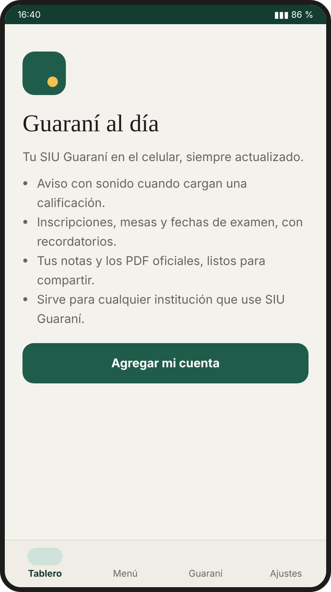
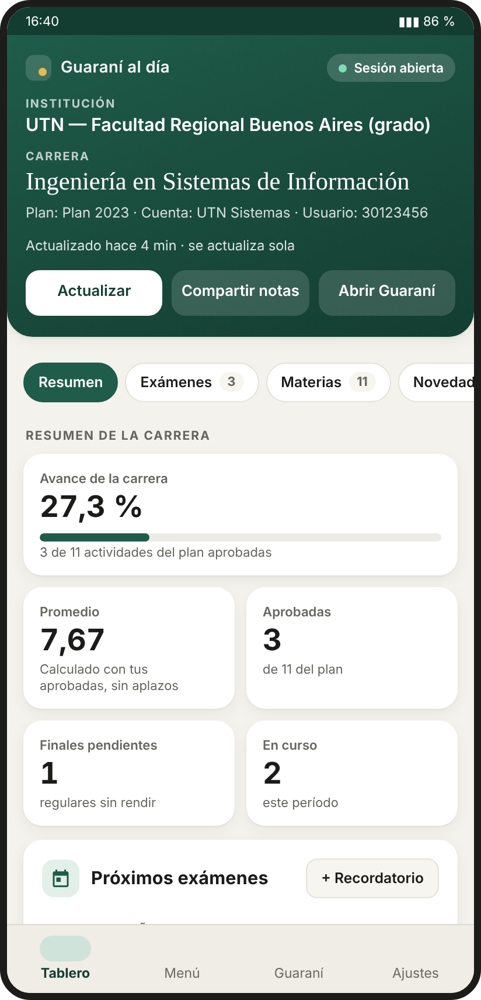
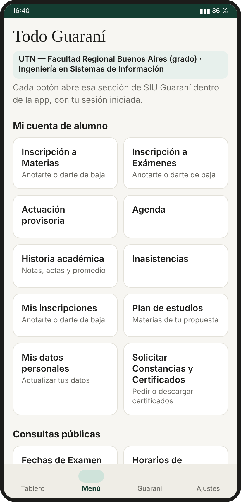
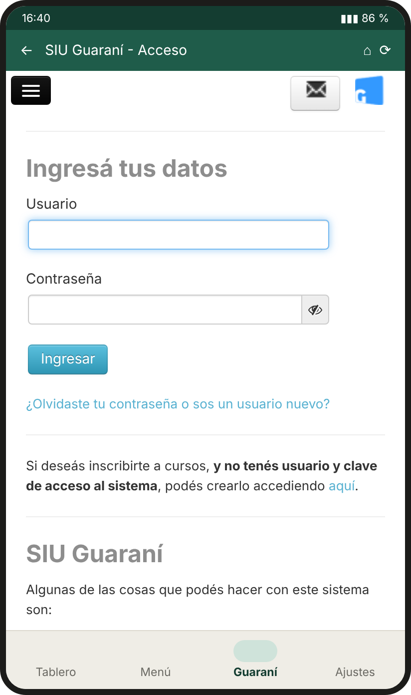
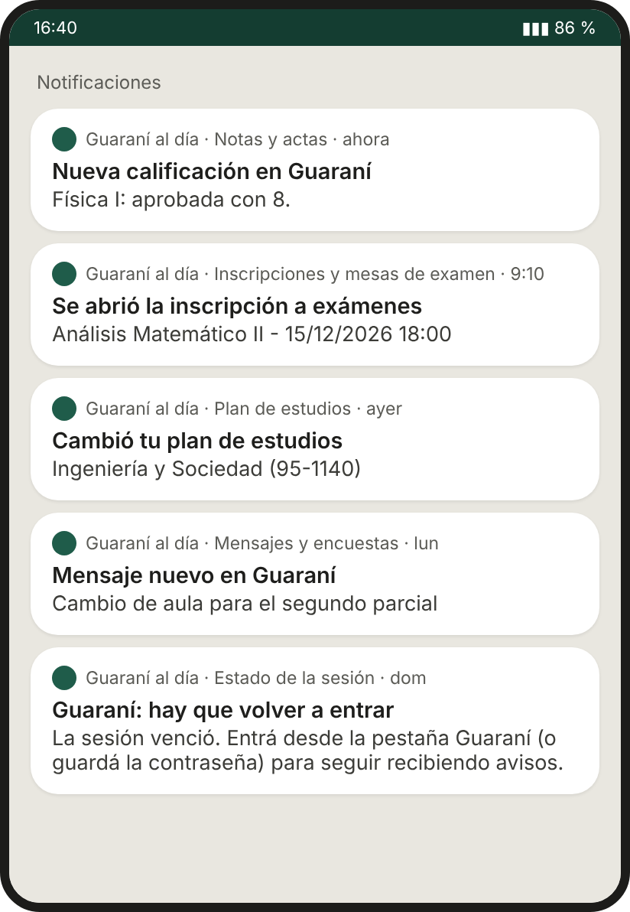
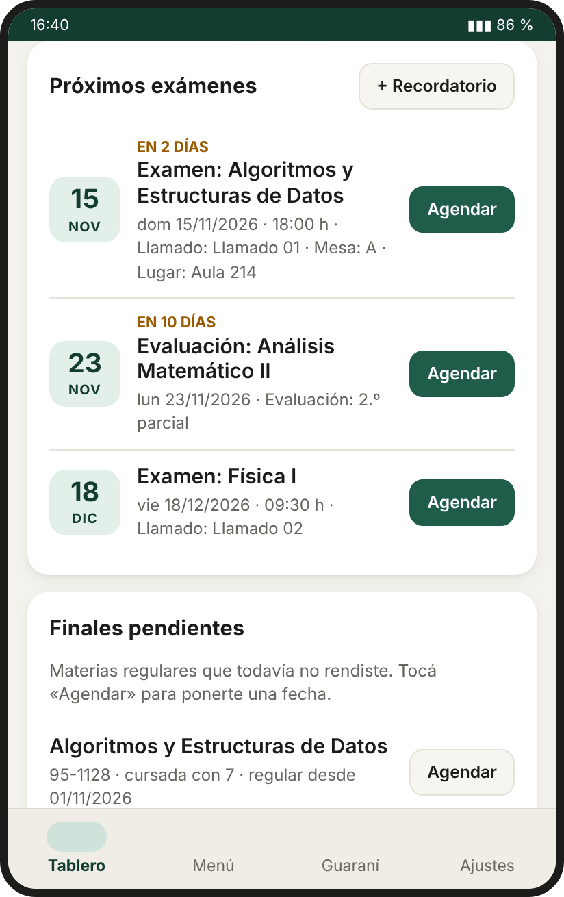
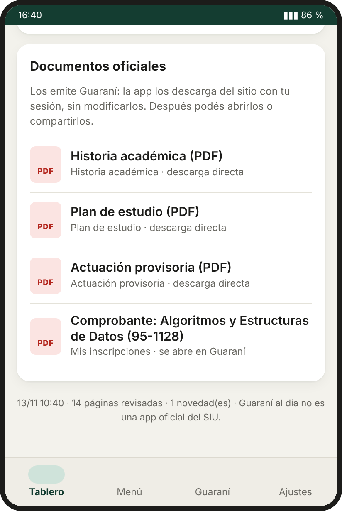
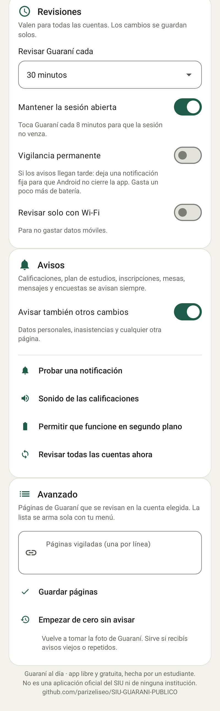

# Guaraní al día — Manual de uso

**Versión 1.4 · noviembre de 2026**

Guaraní al día es una aplicación para Android, libre y gratuita, para estudiantes de cualquier
universidad o instituto que use **SIU Guaraní**. Trae tu Guaraní completo adentro de la app, lo
revisa sola cada cierto tiempo y te avisa al celular cuando cargan una nota, se abre una
inscripción o cambia algo.

> No es una aplicación oficial del SIU ni de ninguna institución. La hizo un estudiante y el
> código está abierto en [github.com/parizeliseo/SIU-GUARANI-PUBLICO](https://github.com/parizeliseo/SIU-GUARANI-PUBLICO).

## Contenido

1. [Qué hace y qué no hace](#1-qué-hace-y-qué-no-hace)
2. [Qué necesitás](#2-qué-necesitás)
3. [Instalar la app](#3-instalar-la-app)
4. [Agregar tu cuenta](#4-agregar-tu-cuenta)
5. [La primera revisión](#5-la-primera-revisión)
6. [Las cuatro pestañas](#6-las-cuatro-pestañas)
7. [Los avisos](#7-los-avisos)
8. [Compartir tus calificaciones](#8-compartir-tus-calificaciones)
9. [Exámenes, recordatorios y Google Calendar](#9-exámenes-recordatorios-y-google-calendar)
10. [Documentos PDF oficiales](#10-documentos-pdf-oficiales)
11. [Tu carrera y tu institución, siempre a la vista](#11-tu-carrera-y-tu-institución-siempre-a-la-vista)
12. [La sesión, siempre abierta](#12-la-sesión-siempre-abierta)
13. [Varias cuentas](#13-varias-cuentas)
14. [Tu contraseña y tu privacidad](#14-tu-contraseña-y-tu-privacidad)
15. [Si tu institución no está en la lista](#15-si-tu-institución-no-está-en-la-lista)
16. [Ajustes, uno por uno](#16-ajustes-uno-por-uno)
17. [Problemas frecuentes](#17-problemas-frecuentes)
18. [Límites conocidos](#18-límites-conocidos)
19. [Actualizar y desinstalar](#19-actualizar-y-desinstalar)
20. [Ayuda](#20-ayuda)

## 1. Qué hace y qué no hace

**Lo que hace:**

- Te muestra un **tablero** con tu institución y tu carrera bien a la vista, tu promedio, tu
  avance y **todas las materias de tu plan** con su estado y su nota.
- Te **avisa** con una notificación cuando hay una calificación nueva (con un **sonido propio**),
  un cambio en el plan de estudios, una inscripción que se abre, una fecha de examen nueva, un
  mensaje o una encuesta.
- Te **recuerda los exámenes** una semana antes, el día anterior y el mismo día, y los pasa a
  **Google Calendar** (o al calendario que uses) con un toque.
- Te deja **compartir tus calificaciones** por WhatsApp, mail o cualquier app.
- Te da los **PDF oficiales** que emite Guaraní (historia académica, plan, comprobantes), tal cual
  los entrega el sitio, para abrirlos o compartirlos.
- Se **actualiza sola**: en segundo plano y cada vez que abrís la app.
- Te deja usar **Guaraní completo** sin salir de la app: inscribirte, pedir certificados, subir
  documentación.
- Mantiene tu **sesión abierta** para que los avisos no se corten.
- Maneja **varias cuentas**: una por facultad o institución.

**Lo que no hace:**

- No se inscribe a nada por vos ni cambia nada en Guaraní: solo mira. Los únicos botones que toca
  sola son los que **muestran** información («Historia completa», «Expandir» el plan). Lo que
  hagas en la pestaña Guaraní lo hacés vos, igual que en el navegador.
- No arma documentos propios: los PDF son los de Guaraní, sin modificar.
- No avisa al instante. Revisa cada cierto tiempo (cada 15 minutos como mínimo), así que el aviso
  llega en la revisión siguiente al cambio.
- No manda tus datos a ningún servidor propio ni de terceros. La app habla únicamente con el
  Guaraní de tu institución.

## 2. Qué necesitás

- Un teléfono con **Android 8.0 o más nuevo**.
- Tu **usuario y contraseña** de SIU Guaraní (autogestión de alumnos).
- Conexión a internet, por datos o por Wi-Fi.
- Que tu institución use **SIU Guaraní 3**. Si en el navegador la pantalla de ingreso dice
  «SIU Guaraní», sirve.

## 3. Instalar la app

La app no está en Google Play: se descarga desde GitHub.

1. Desde el celular, entrá a
   [github.com/parizeliseo/SIU-GUARANI-PUBLICO](https://github.com/parizeliseo/SIU-GUARANI-PUBLICO),
   abrí la carpeta **publicado** y tocá el archivo `Guarani-al-dia-….apk`. Después tocá
   **Download** (o el ícono de descarga).
2. Cuando termine, abrí el archivo desde la notificación de descarga o desde la app *Archivos*.
3. Android te va a preguntar si permitís instalar apps de esta fuente (el navegador o *Archivos*).
   Tocá **Configuración**, activá **Permitir desde esta fuente** y volvé atrás.
4. Tocá **Instalar**.
5. Si aparece un aviso de *Play Protect* diciendo que no reconoce la app o al desarrollador, tocá
   **Más detalles → Instalar de todas formas**. Es normal en apps que no vienen de la tienda: no
   quiere decir que haya encontrado algo malo.
6. Abrí la app. Cuando pida permiso para **enviar notificaciones**, tocá **Permitir**: sin ese
   permiso no puede avisarte nada.

*La pantalla que ves al abrir la app por primera vez.*

Al abrirla por primera vez vas a ver la pantalla de bienvenida. El paso siguiente es agregar tu
cuenta de Guaraní.

## 4. Agregar tu cuenta

*La parte «Cuenta» y «Datos de la cuenta» de Ajustes, con datos de ejemplo.*

La primera vez, la app te recibe con una pantalla de bienvenida. Tocá **Agregar mi cuenta** y
se abre la pestaña **Ajustes**. Completá los datos en este orden:

1. **Institución o facultad.** Escribí parte del nombre (por ejemplo *UTN*, *UNC* o *IUGNA*) y
   elegila de la lista que se despliega. Si no aparece, mirá el
   [capítulo 15](#15-si-tu-institución-no-está-en-la-lista).
2. **Dirección de SIU Guaraní.** Se completa sola cuando elegís la institución. No la toques,
   salvo que la tuya no esté en la lista.
3. **Nombre de esta cuenta.** Es el nombre con el que la vas a ver en la app. Poné lo que
   quieras: *UTN Sistemas*, *Licenciatura*, *Diplomatura*. (El campo **Carrera o propuesta**,
   justo arriba, dejalo vacío: se completa solo.)
4. **Usuario.** El mismo con el que entrás a Guaraní: DNI, legajo o e-mail, según tu institución.
5. **Contraseña.** La de Guaraní.
6. **Guardar la contraseña en este teléfono.** Viene tildado, y conviene dejarlo así: con la
   contraseña guardada, la app vuelve a entrar sola cuando la sesión vence. El
   [capítulo 14](#14-tu-contraseña-y-tu-privacidad) explica cómo se guarda.
7. Tocá **Agregar cuenta y revisar**.

Después, más abajo en la misma pantalla, tocá **Permitir que funcione en segundo plano** y
aceptá. Así el ahorro de batería de Android no frena las revisiones.

## 5. La primera revisión

Apenas agregás la cuenta, la app entra a tu Guaraní y recorre las páginas de tu menú. Tarda
entre uno y tres minutos.

Esa primera revisión **no te avisa nada**: toma una «foto» de cómo está tu Guaraní hoy (tus
materias, tus notas, tu plan, tus inscripciones). Desde la segunda revisión, compara con la foto
anterior y te avisa todo lo que cambió.

En esa primera revisión la app también lee **tu carrera**, tu **plan de estudio completo**, tu
**historia académica completa** y tus **inscripciones**, y con eso arma el tablero.

Para saber si salió bien, mirá el encabezado del tablero: tiene que decir *«Actualizado hace X
min»* y mostrar tu carrera. Al pie del tablero está el detalle, por ejemplo *«13/11 10:40 · 14
páginas revisadas · sin cambios»*. Si dice otra cosa, buscá el mensaje en
[Problemas frecuentes](#17-problemas-frecuentes).

## 6. Las cuatro pestañas

Abajo de todo hay cuatro pestañas. Todas muestran la cuenta que tengas elegida.

### Tablero

*El tablero, con datos de ejemplo.*

Es el resumen de tu carrera, de arriba hacia abajo:

- **Encabezado verde.** Dice con letras grandes **qué institución** y **qué carrera** estás
  viendo, el plan, el nombre de la cuenta y el usuario. A la derecha, si la **sesión está
  abierta** o cerrada. Debajo, cuándo se actualizó por última vez.
- **Botones:** *Actualizar* lee Guaraní en el momento (también podés **deslizar hacia abajo**);
  *Compartir notas* manda tus calificaciones por WhatsApp, mail, etc.; *Abrir Guaraní* va al
  sitio.
- **Indicadores:** avance de la carrera (materias aprobadas sobre el total del plan, con barra),
  promedio, aprobadas, finales pendientes y materias en curso. Debajo de cada número dice de
  dónde sale: por ejemplo, si el promedio lo informa Guaraní o lo calcula la app con tus notas
  aprobadas.
- **Inscripciones abiertas ahora** (solo cuando hay alguna): las materias con mesa de examen o
  comisión habilitada, con el llamado y la fecha, y el botón **Inscribirme**, que abre la
  inscripción en Guaraní.
- **Próximos exámenes:** las mesas a las que estás inscripto y las evaluaciones con fecha, con
  cuántos días faltan y el botón **Agendar**. Ver [Exámenes, recordatorios y Google
  Calendar](#9-exámenes-recordatorios-y-google-calendar).
- **Finales pendientes:** las materias regulares que todavía no rendiste.
- **Novedades:** el historial de todo lo que cambió, lo más reciente arriba. *Ver todas*
  muestra la lista completa.
- **Materias y calificaciones:** todas las materias de tu plan con su estado (aprobada,
  promocionada, regular, en curso, pendiente, desaprobada) y la nota. Tiene un **buscador** (por
  nombre o código, sin importar los acentos) y **filtros** arriba. Tocá una materia para ver su
  historia: por ejemplo, *«Examen aprobado con 8 (20/02/2026) · Examen desaprobado con 2
  (12/12/2025)»*. Si una nota todavía no está en un acta cerrada, aparece la marca
  **PROVISORIA**.
- **Documentos oficiales:** los PDF que ofrece tu Guaraní. Ver [Documentos PDF
  oficiales](#10-documentos-pdf-oficiales).

*Materias con buscador y filtros. El botón Compartir manda lo que estás filtrando.*

### Menú

*Todas las secciones de tu Guaraní, ordenadas por tema.*

Reúne todo lo que tiene tu Guaraní. Cada opción abre esa sección en la pestaña Guaraní, con tu
sesión ya iniciada. Arriba muestra la institución y la carrera de la cuenta, y tiene un
**buscador**: escribí, por ejemplo, *certificado* o *mesa* y quedan solo esas opciones.

Las secciones de tu menú real aparecen después de la primera revisión, cambian según lo que
ofrezca tu institución y se ordenan en grupos:

- **Inscripciones:** a materias, a exámenes y tus inscripciones.
- **Reportes:** historia académica, plan de estudios, actuación provisoria, agenda,
  inasistencias.
- **Trámites:** certificados, constancias y datos personales.
- **Comunicación:** mensajes y encuestas.
- **Otras secciones:** lo que no entre en los grupos anteriores.

Además, siempre están:

- **Consultas públicas:** lo que se puede ver sin ingresar, como fechas de examen, horarios de
  cursadas y el validador de certificados.
- **Acceso y ayuda:** ingresar, recuperar la contraseña y el formulario de ayuda.

### Guaraní

*El sitio de tu institución, dentro de la app.*

Es el sitio de Guaraní de tu institución, completo. Todo lo que hacés en el navegador lo podés
hacer acá: inscribirte, darte de baja, pedir un certificado, subir un archivo.

- Si la contraseña está guardada, **entra sola**. Si no, ingresás a mano y la app te pregunta
  si querés guardarla.
- La barra de arriba muestra la página, y debajo **la institución y la carrera** de la cuenta.
  Tiene **atrás** (←), **guardar como PDF** (⤓), **inicio** (⌂) y **recargar** (⟳).
- Los archivos que descargues (certificados, comprobantes, reportes en PDF) van a la carpeta
  **Descargas**. Cuando termina la descarga, la app te ofrece **Abrir** o **Compartir**.
- Podés acercar y alejar la página con dos dedos.

### Ajustes

Está ordenada en tarjetas: **Cuenta**, **Datos de la cuenta**, **Revisiones**, **Avisos** y
**Avanzado**. Está explicada opción por opción en [Ajustes, uno por uno](#16-ajustes-uno-por-uno).

## 7. Los avisos

*Ejemplos de avisos, como se ven en la barra de notificaciones.*

Cada tema tiene su propio aviso, con un título que dice qué pasó. Para tener en cuenta:

- Los avisos de **notas, plan de estudios, inscripciones, mesas, mensajes y encuestas** llegan
  **siempre**. Los de «otros cambios» se pueden apagar en Ajustes con *Avisar también otros
  cambios*.
- Al **tocar un aviso** se abre la app en la cuenta que corresponde.
- Con varias cuentas, el título empieza con el nombre de la cuenta: *«UTN Sistemas · Nueva
  calificación en Guaraní»*.
- Todo aviso queda además anotado en **Novedades**, en el tablero, así que no se pierde aunque
  lo descartes.
- El aviso llega en la revisión siguiente al cambio, no al instante.

Estos son todos los avisos:

| Qué pasó en Guaraní | Título del aviso | Canal | Botón |
|---|---|---|---|
| Se cargó o cambió una calificación, una promoción, una regularidad o un acta | **Nueva calificación en Guaraní**, con la materia, el tipo y la nota (*«Física I: examen aprobado con 8.»*) | Calificaciones nuevas (con sonido propio) | Compartir |
| Apareció una fecha de examen o de evaluación | **Nueva fecha de examen** / **Nueva evaluación** | Inscripciones y mesas de examen | Agendar |
| Falta una semana, un día o es hoy | **En una semana / Mañana / Hoy: Examen: …** | Recordatorios de examen | Agendar |
| Cambió algo en tu plan de estudios | **Cambió tu plan de estudios** | Plan de estudios | — |
| Se habilitó una mesa de examen en una materia | **Inscripción a examen abierta: Geopolítica**, con el llamado y la fecha | Inscripciones y mesas de examen | Al tocarlo abre la inscripción en Guaraní |
| Apareció otra mesa en una materia que ya tenía | **Nueva mesa de examen: …** | Inscripciones y mesas de examen | Abre la inscripción |
| Se habilitó una comisión para cursar una materia | **Inscripción a materia abierta: …** | Inscripciones y mesas de examen | Abre la inscripción |
| Se abrió o se cerró la inscripción a exámenes | **Se abrió la inscripción a exámenes** / **Cerró la inscripción a exámenes** | Inscripciones y mesas de examen | — |
| Apareció una mesa de examen nueva | **Novedades en mesas de examen** | Inscripciones y mesas de examen | — |
| Se abrió o se cerró la inscripción a materias | **Se abrió la inscripción a materias** / **Cerró la inscripción a materias** | Inscripciones y mesas de examen | — |
| Cambió algo en tus inscripciones | **Novedades en tus inscripciones** | Inscripciones y mesas de examen | — |
| Llegó un mensaje de la institución, o hay una encuesta | **Mensaje nuevo en Guaraní** / **Encuesta en Guaraní** | Mensajes y encuestas | — |
| Cambió cualquier otra cosa | **Cambió algo en…** y el nombre de la sección | Otros cambios en Guaraní | — |
| La app no puede entrar a Guaraní | **Guaraní: hay que volver a entrar** | Estado de la sesión | — |

Cómo se escribe cada calificación: *«cursada aprobada con 7 (queda el final)»* para una
regularidad, *«examen aprobado con 8»*, *«promocionada con 9»*, *«aprobada por equivalencia»*,
*«ausente en el examen»*. Si la nota todavía es provisoria (el acta no está cerrada), el aviso
lo dice: *«nota provisoria, examen aprobado con 9»*.

**Inscripciones habilitadas, materia por materia.** En muchas instituciones, *Inscripción a
exámenes* e *Inscripción a materias* muestran todas tus materias, y las mesas o comisiones
aparecen recién al elegir una (si no hay, Guaraní dice *«No hay mesas habilitadas para esta
actividad»*). En cada revisión la app entra a leer cada materia, **sin tocar nada**, y te avisa
apenas una pasa a tener mesa o comisión habilitada. Al tocar el aviso se abre esa inscripción en
la pestaña Guaraní para que te anotes. La app **nunca te inscribe sola**. Si al instalarla ya hay
una inscripción abierta, también te avisa, una sola vez.

**El sonido de las calificaciones.** Las calificaciones nuevas suenan con un tono propio, de tres
notas, distinto del resto de los avisos, y vibran. Para cambiar el tono o subirle la importancia,
tocá **Sonido de las calificaciones** en Ajustes. Si el teléfono está en silencio o en *No
molestar*, no suena.

**Silenciar o cambiar el sonido de un tema.** Cada canal se maneja por separado desde Android:
mantené apretado un aviso de la app y tocá el engranaje, o entrá a *Configuración del teléfono →
Apps → Guaraní al día → Notificaciones*. Ahí podés apagar un canal, cambiarle el sonido o dejarlo
silencioso sin tocar los demás. Los canales son: *Calificaciones nuevas*, *Inscripciones y mesas
de examen*, *Recordatorios de examen*, *Plan de estudios*, *Mensajes y encuestas*, *Otros
cambios en Guaraní*, *Estado de la sesión* y *Vigilancia permanente*.

**Probar que los avisos llegan.** En Ajustes, tocá **Probar una notificación**. Si no aparece nada,
la app no tiene permiso para notificar: activalo en *Configuración del teléfono → Apps → Guaraní
al día → Notificaciones*.

## 8. Compartir tus calificaciones

Hay tres formas:

1. **Todo:** en el tablero, tocá **Compartir notas** (arriba) o **Compartir** en *Materias y
   calificaciones* con el filtro *Todas*.
2. **Una parte:** elegí un filtro (por ejemplo *Aprobadas*) y tocá **Compartir**: se manda solo
   eso.
3. **Una nota nueva:** en el aviso de *Nueva calificación*, tocá **Compartir**.

Android te muestra las apps para mandarlo: WhatsApp, Telegram, Gmail, Drive, Mensajes… El texto
queda así:

> Mis calificaciones — Ingeniería en Sistemas de Información  
> UTN — Facultad Regional Buenos Aires (grado)  
> Promedio: 7,67 · Aprobadas: 3 de 11  
>
> Aprobadas (3)  
> • Análisis Matemático I — 7 · 12/07/2026  
> • Física I — 8 (provisoria) · 13/11/2026  
> • Álgebra y Geometría Analítica — 8 (promoción) · 20/07/2026  
>
> Regulares (falta el final) (1)  
> • Algoritmos y Estructuras de Datos — 7  

Las materias pendientes del plan se resumen en un número, para que el texto no sea larguísimo.
Si necesitás un documento con valor oficial, usá el **PDF de la historia académica** (ver
[Documentos PDF oficiales](#10-documentos-pdf-oficiales)): el texto compartido es solo informativo.

## 9. Exámenes, recordatorios y Google Calendar

*Exámenes y evaluaciones con fecha, cada uno con su botón Agendar.*

**De dónde salen las fechas.** La app las lee de *Mis inscripciones* (las mesas a las que estás
inscripto, con su hora, llamado, mesa y lugar), del panel de exámenes de la portada de Guaraní y,
si tu institución lo usa, del *Cronograma de evaluaciones*. Las inscripciones dadas de baja no se
cuentan. Cuando aparece una fecha nueva, llega el aviso **Nueva fecha de examen**.

**Recordatorios automáticos.** Para cada examen, la app te avisa **una semana antes**, **el día
anterior** y **el mismo día**. Solo entre las 8 y las 22: nunca de madrugada.

**Pasarlo a Google Calendar.** Tocá **Agendar** (en el tablero o en el aviso). Se abre tu app de
calendario con el examen ya cargado: título, día, hora (dos horas de duración) y, en la
descripción, el llamado, la mesa, el lugar, tu institución y tu carrera. Elegí en qué calendario
guardarlo y, si querés, agregale un aviso propio; después tocá **Guardar**. Si el examen no tiene
hora, se agenda como evento de todo el día.

- Funciona con **Google Calendar** y con cualquier calendario instalado (Samsung, Outlook…).
- La app **no pide permiso para leer tu calendario** ni escribe nada sola: vos confirmás cada
  evento.
- **Finales pendientes:** cada materia regular tiene su botón **Agendar**, para ponerte una fecha
  de estudio o de final. Y **+ Recordatorio** abre el calendario con un evento en blanco.

## 10. Documentos PDF oficiales

*Los PDF que ofrece tu Guaraní, listos para abrir o compartir.*

En cada revisión, la app anota los PDF y comprobantes que tu Guaraní ofrece: el de la historia
académica, el del plan de estudio, el de la actuación provisoria, los comprobantes de inscripción
a materias y exámenes, y los demás que tenga tu institución. Aparecen en **Documentos oficiales**,
al final del tablero.

**Los PDF son los originales.** La app no arma ni modifica ningún documento: lo pide a tu Guaraní
con tu sesión y lo guarda tal como lo entrega el sitio.

- **Descarga directa:** al tocarlo, Guaraní genera el PDF y se guarda en **Descargas**. Cuando
  termina, la app ofrece **Abrir** o **Compartir**.
- **Se abre en Guaraní:** algunos comprobantes se generan con un botón dentro de la página. La
  app abre esa página y vos tocás el botón *Generar* o el ícono de PDF.
- **Guardar cualquier pantalla como PDF:** en la pestaña Guaraní, el botón **⤓** de la barra
  guarda la página que estás viendo, tal como la muestra el sitio. Sirve para pantallas que
  Guaraní no ofrece en PDF. Ojo: eso es una copia de la pantalla, no un documento emitido por
  Guaraní.
- Las **constancias y certificados con firma** se piden desde *Menú → Solicitar constancias y
  certificados*, igual que en la web.

## 11. Tu carrera y tu institución, siempre a la vista

Todas las pantallas dicen qué estás viendo:

- **Tablero:** el encabezado verde muestra *Institución* y *Carrera* con letras grandes, el plan,
  el nombre de la cuenta y el usuario.
- **Menú:** debajo del título, *institución · carrera*.
- **Pestaña Guaraní:** debajo del título de la página, *institución · carrera*.
- **Avisos:** con varias cuentas, empiezan con el nombre de la cuenta, y debajo del texto dicen la
  carrera.

**De dónde sale la carrera.** La app la lee de Guaraní: del dato *Propuesta* del plan de estudio
o del selector de propuesta de arriba de la página. Si preferís otro nombre (por ejemplo, uno más
corto), escribilo en *Ajustes → Carrera o propuesta*.

**Si tenés más de una propuesta con el mismo usuario** (por ejemplo, una carrera y una
diplomatura), Guaraní muestra los datos de la que está elegida en su selector, y la app sigue esa
misma. El tablero te avisa cuando hay más de una. Para ver la otra:

- cambiala en la pestaña Guaraní y tocá **Actualizar**; o
- mejor, creá **dos cuentas** con el mismo usuario y escribí en cada una su carrera (ver [Varias
  cuentas](#13-varias-cuentas)).

## 12. La sesión, siempre abierta

Para poder avisarte, la app necesita tener abierta tu sesión de Guaraní. Guaraní cierra las
sesiones que pasan un rato sin uso, así que la app hace tres cosas:

1. **Toca Guaraní cada 8 minutos.** Es un pedido liviano que le dice a Guaraní que seguís ahí.
   Es la opción *Mantener la sesión abierta*, que viene activada.
2. **Vuelve a entrar sola si la sesión venció.** Puede pasar si Guaraní se reinició o el
   teléfono estuvo un rato largo sin red. Para esto necesita la **contraseña guardada**. Si no
   la guardaste, te avisa una vez para que entres a mano desde la pestaña Guaraní.
3. **Vigilancia permanente** (opcional). Deja una notificación fija que impide que Android
   cierre la app. Conviene activarla si los avisos te llegan tarde o no llegan.

**Teléfonos que cierran las apps.** Algunas marcas frenan las apps en segundo plano para ahorrar
batería, y eso atrasa los avisos. Si te pasa:

- Tocá **Permitir que funcione en segundo plano** en Ajustes.
- Activá **Vigilancia permanente**.
- En la configuración del teléfono, buscá la app y sacale las restricciones de batería. El
  nombre de la opción cambia según la marca:

| Marca | Dónde suele estar |
|---|---|
| Samsung | Configuración → Apps → Guaraní al día → Batería → **Sin restricciones** |
| Xiaomi / Redmi / POCO | Configuración → Apps → Guaraní al día → Ahorro de batería → **Sin restricciones**, y activar **Inicio automático** |
| Motorola | Configuración → Apps → Guaraní al día → Uso de batería → **Sin restricciones** |
| Otros | Configuración → Apps → Guaraní al día → Batería |

**Qué pasa si el teléfono está apagado o sin internet.** No hay revisión. Cuando vuelve la
conexión, la app se pone al día y te avisa junto todo lo que cambió mientras tanto.

**Actualización automática.** Además de las revisiones en segundo plano, **cada vez que abrís la
app** se fija cuándo leyó Guaraní por última vez: si pasaron más de 10 minutos, se actualiza sola
en ese momento. No hace falta tocar nada.

## 13. Varias cuentas

*Con dos o más cuentas aparece un selector arriba del tablero.*

Podés tener una cuenta por cada facultad o institución, o más de un usuario en la misma.

- **Agregar otra:** en Ajustes tocá **+ Nueva** y completá los datos igual que la primera vez.
  Cuando ya tenés dos o más, también aparece el botón **+ Cuenta** arriba del tablero.
- **Pasar de una a otra:** elegila en el selector de arriba del tablero o en la lista de
  Ajustes. El tablero, el menú y la pestaña Guaraní cambian a esa cuenta.
- **Revisión:** la app revisa todas las cuentas, una detrás de otra, aunque no la tengas elegida.
- **Avisos:** cada aviso dice de qué cuenta es.
- **Dos carreras con el mismo usuario:** creá una cuenta por carrera y escribí en cada una su
  *Carrera o propuesta* en Ajustes, así no se confunden.
- **Dos cuentas en el mismo Guaraní:** se puede. La app cierra la sesión de una antes de abrir la
  otra para no mezclar datos. En ese caso conviene guardar la contraseña de las dos.
- **Borrar una cuenta:** en Ajustes, elegila y tocá **Borrar esta cuenta del teléfono**. Se
  borran del teléfono su contraseña, sus notas guardadas y sus novedades. En Guaraní no cambia
  nada.

## 14. Tu contraseña y tu privacidad

**Guardar la contraseña es opcional.** Esta es la diferencia:

| | Con la contraseña guardada | Sin guardarla |
|---|---|---|
| Revisión en segundo plano | Siempre. Si la sesión vence, la app vuelve a entrar sola. | Mientras dure la sesión que abriste en la pestaña Guaraní. Cuando vence, te avisa para que vuelvas a entrar. |
| Dónde queda | En el teléfono, cifrada. | En ningún lado. |

**Cómo se guarda.** Queda cifrada con el *Android Keystore*, el sistema de seguridad del propio
teléfono. No se guarda en texto legible ni sale del teléfono, salvo para ingresar a Guaraní: se
envía únicamente a la dirección de Guaraní de esa cuenta, o a la página de ingreso de tu
institución cuando Guaraní te manda ahí. Las copias de seguridad de Android están desactivadas
para esta app, así que la contraseña tampoco viaja a la nube.

**Guardarla después.** Si no la guardaste al crear la cuenta e ingresás a mano desde la pestaña
Guaraní, la app te pregunta: **Guardar**, **Ahora no** o **Nunca para esta cuenta**.

**Cambiarla.** Si cambiaste la contraseña en Guaraní, la app no va a poder entrar y te va a
avisar. Andá a Ajustes, elegí la cuenta, escribí la contraseña nueva y tocá **Guardar cambios y
revisar**.

**Borrarla.** En Ajustes, destildá *Guardar la contraseña en este teléfono* y tocá **Guardar
cambios y revisar**. O borrá la cuenta.

**Qué guarda la app en el teléfono.** La dirección de tu Guaraní, tu usuario y tu contraseña
(cifrados), tus materias y notas, las fechas de examen, y el texto de las páginas que revisó,
para poder comparar. Nada de eso se envía a otro lado. Tampoco viaja al pasar los datos a un
teléfono nuevo: ahí hay que volver a agregar las cuentas. Al desinstalar la app se borra todo.

**Protecciones de la app.**

- Solo usa conexiones cifradas (https). Si escribís una dirección de Guaraní que empieza con
  `http://`, la app no la acepta.
- La contraseña se completa solo en páginas https de tu institución o en la página de ingreso único a
  la que Guaraní te manda en ese momento, nunca en otra página.
- Otra app del teléfono no puede abrirla para compartir o agendar cosas en tu nombre: los botones de
  las notificaciones llevan una clave que solo conoce tu instalación.
- No pide permisos de ubicación, contactos, calendario, cámara, micrófono ni archivos.

**Comprobar que el APK es el original.** En el README del repositorio están la huella del
certificado de firma y la suma SHA-256 de cada versión. Además, Android solo instala una
actualización encima de la anterior si la firma coincide.

**Calendario y compartir.** La app no tiene permiso para leer tu calendario ni tus contactos.
Cuando tocás *Agendar* o *Compartir*, se abre la otra app con los datos cargados y sos vos quien
confirma.

## 15. Si tu institución no está en la lista

La app funciona igual: solo necesita la dirección de tu Guaraní.

1. Abrí en el navegador el Guaraní donde entrás siempre, hasta ver la pantalla de ingreso.
2. Copiá la dirección de la barra del navegador. Suele terminar en `/autogestion/` o parecido.
3. En Ajustes, dejá vacío *Institución o facultad* y pegá la dirección en **Dirección de SIU
   Guaraní**. Si pegás la dirección de la pantalla de ingreso (termina en `/acceso`), la app la
   acomoda sola.
4. Completá el resto y tocá **Agregar cuenta y revisar**.

Si funciona, podés pedir que se sume a la lista para todos desde
[el formulario de GitHub](https://github.com/parizeliseo/SIU-GUARANI-PUBLICO/issues/new?template=nueva-institucion.yml).
No hace falta poner usuario ni contraseña: solo la dirección.

**Direcciones que no sirven:**

- Las que muestran **«Guaraní – Autentificación de Usuarios»** o **«SIU-Guaraní Gestión»**: son
  el Guaraní del personal administrativo, no la autogestión de alumnos.
- Las que empiezan con `http://` en vez de `https://`: Android bloquea esas conexiones por
  seguridad.
- Las armadas «por fórmula» (`guarani.` más la sigla de la universidad): la mayoría no existe.
  La dirección buena es la que te da tu facultad.

**Instituciones incluidas en esta versión:**

<!-- INSTITUCIONES:INICIO -->
| Institución | Dirección |
|---|---|
| IUGNA — Instituto Universitario de Gendarmería Nacional | `https://siu.iugna.edu.ar/autogestion/` |
| IUPA — Instituto Universitario Patagónico de las Artes | `https://guarani.iupa.edu.ar/autogestion/` |
| IUSE — Instituto Universitario de Seguridad | `https://autogestion.iuse.edu.ar/` |
| UBA — Ciclo Básico Común (CBC) | `https://guarani.uba.ar/cbc/` |
| UBA — Facultad de Agronomía | `https://guarani.agro.uba.ar/agro/` |
| UBA — Facultad de Ciencias Veterinarias | `https://guarani.fvet.uba.ar/veterinaria/` |
| UBA — Facultad de Farmacia y Bioquímica | `https://guarani.ffyb.uba.ar/ffyb/` |
| UNaF — Universidad Nacional de Formosa | `https://guarani.unf.edu.ar/autogestion/` |
| UNAJ — Universidad Nacional Arturo Jauretche | `https://guarani.unaj.edu.ar/autogestion/` |
| UNC — Universidad Nacional de Córdoba | `https://autogestion.guarani.unc.edu.ar/` |
| UNCA — Universidad Nacional de Catamarca | `https://guarani.unca.edu.ar/autogestion/` |
| UNDEF — Facultad de Ingeniería del Ejército (FIE) | `https://www.fie.undef.edu.ar/siu/3w/` |
| UNDEF — Instituto Universitario Aeronáutico (IUA) | `https://autogestion.iua.edu.ar/` |
| UNIPE — Universidad Pedagógica Nacional | `https://guarani.unipe.edu.ar/autogestion/` |
| UNJu — Universidad Nacional de Jujuy | `https://alumnos.unju.edu.ar/unju/` |
| UNLP — Universidad Nacional de La Plata | `https://autogestion.guarani.unlp.edu.ar/` |
| UNQ — Universidad Nacional de Quilmes | `https://autogestion.uvq.edu.ar/unq/` |
| UNR — Universidad Nacional de Rosario | `https://autogestion-guarani.unr.edu.ar/` |
| UNRaf — Universidad Nacional de Rafaela | `https://guarani.unraf.edu.ar/autogestion/` |
| UNRN — Universidad Nacional de Río Negro | `https://guarani.unrn.edu.ar/g3w3/` |
| UNSE — Universidad Nacional de Santiago del Estero | `https://autogestion.guarani.unse.edu.ar/unse/` |
| UNSJ — Universidad Nacional de San Juan | `https://autogestion.guarani.unsj.edu.ar/` |
| UNT — Universidad Nacional de Tucumán | `https://guarani.unt.edu.ar/autogestion/` |
| UNTREF — Universidad Nacional de Tres de Febrero | `https://autogestion.untref.edu.ar/` |
| UNVM — Universidad Nacional de Villa María | `https://autogestiong3.unvm.edu.ar/unvm/` |
| UTN — Facultad Regional Buenos Aires (grado) | `https://guarani.frba.utn.edu.ar/autogestion/grado/` |
| UTN — Facultad Regional Concepción del Uruguay | `https://guarani.frcu.utn.edu.ar/autogestion/` |
<!-- INSTITUCIONES:FIN -->

## 16. Ajustes, uno por uno

*Las tarjetas Revisiones, Avisos y Avanzado.*

La pestaña Ajustes está ordenada en cinco tarjetas, una debajo de la otra:

- **Cuenta:** qué cuenta estás viendo, el botón **+ Nueva** y la línea de estado.
- **Datos de la cuenta:** dónde estudiás y tu usuario de Guaraní. Es lo único que hay que
  completar para empezar.
- **Revisiones:** cada cuánto se revisa. Vale para todas las cuentas.
- **Avisos:** qué se avisa y los botones para probar y configurar las notificaciones.
- **Avanzado:** qué páginas se vigilan en la cuenta elegida.

Dos cosas para recordar:

- Los datos de una cuenta se guardan con **Guardar cambios y revisar** (o **Agregar cuenta y
  revisar** si es nueva).
- Las opciones de Revisiones y Avisos **se guardan solas** apenas las cambiás.

En la tarjeta Cuenta, la línea de estado dice cuándo se revisó esa cuenta por última vez y
cómo salió. Es lo primero que conviene mirar si algo no anda.

### Cuenta y Datos de la cuenta

| Opción | Para qué sirve |
|---|---|
| Lista de cuentas | Elegir qué cuenta ver y editar. *(cuenta nueva)* deja los campos vacíos para agregar una. |
| **+ Nueva** | Empezar una cuenta nueva. |
| Institución o facultad | Buscar tu institución en la lista. Al elegirla se completa la dirección. |
| Dirección de SIU Guaraní | La dirección de autogestión. Se puede escribir a mano. |
| Nombre de esta cuenta | El nombre con el que la ves en la app y en los avisos. |
| Carrera o propuesta | Se completa sola con la que la app lee de Guaraní (debajo dice «Leída de Guaraní: …»). Escribila solo si querés verla con otro nombre, o para distinguir dos cuentas del mismo usuario. |
| Usuario y Contraseña | Los de Guaraní. |
| Guardar la contraseña en este teléfono | Si está tildado, la app entra sola cuando la sesión vence. |
| **Guardar cambios y revisar** | Guarda los cambios y hace una revisión de esa cuenta. Si la cuenta es nueva dice **Agregar cuenta y revisar**. |
| **Borrar esta cuenta del teléfono** | Borra la cuenta y todo lo guardado de ella. Pide confirmación. |

### Revisiones y Avisos (todas las cuentas, se guardan solas)

| Opción | Para qué sirve |
|---|---|
| Revisar Guaraní cada | Cada cuánto se hace la revisión completa: 15 minutos, 30 minutos, 1 hora, 2 horas o 6 horas. Más seguido avisa antes y gasta un poco más de batería y de datos. |
| Avisar también otros cambios | Apagado, solo llegan los avisos de notas, plan, inscripciones, mesas, mensajes y encuestas. |
| Revisar solo con Wi-Fi | Para no gastar datos móviles. Sin Wi-Fi no hay revisión completa. |
| Mantener la sesión abierta | Toca Guaraní cada 8 minutos para que la sesión no venza. Conviene dejarlo activado. |
| Vigilancia permanente | Impide que Android cierre la app. Para teléfonos que frenan las apps en segundo plano. |
| **Revisar todas las cuentas ahora** | Revisa todas las cuentas en el momento. |
| **Probar una notificación** | Manda un aviso de prueba de calificación, con su sonido. |
| **Sonido de las calificaciones** | Abre la configuración de Android del canal *Calificaciones nuevas*: tono, vibración e importancia. |
| **Permitir que funcione en segundo plano** | Le pide a Android que no le aplique ahorro de batería a la app. |

### Avanzado (cuenta elegida)

| Opción | Para qué sirve |
|---|---|
| Páginas de Guaraní que se vigilan | La lista de páginas que la app revisa en esa cuenta. Se arma sola con tu menú. Podés borrar una línea para dejar de vigilar esa página, o agregar una dirección. |
| **Guardar páginas** | Guarda la lista. |
| **Empezar de cero sin avisar** | Borra la comparación guardada y empieza de cero, sin mandar avisos. Sirve si la app te avisa cosas viejas o repetidas. |

## 17. Problemas frecuentes

**No puedo escribir en los campos de Ajustes.**
Era una falla de las versiones 1.2 a 1.3.1. Instalá la versión 1.3.2 o una más nueva.

**El aviso de calificación no suena.**
Fijate que el teléfono no esté en silencio ni en *No molestar*. Después tocá *Sonido de las
calificaciones* en Ajustes y revisá que el canal tenga sonido y esté en importancia alta. Si
venías de una versión anterior, la 1.4 crea ese canal nuevo, con el tono propio.

**El tablero muestra otra carrera, o ninguna.**
La app muestra la propuesta elegida en Guaraní. Si tenés varias, cambiala en la pestaña Guaraní
y tocá *Actualizar*, o escribí la carrera en *Ajustes → Carrera o propuesta*. Ver [Tu carrera y
tu institución, siempre a la vista](#11-tu-carrera-y-tu-institución-siempre-a-la-vista).

**No aparecen mis exámenes en «Próximos exámenes».**
Aparecen los que tienen fecha en *Mis inscripciones*. Si tu institución no informa la fecha al
inscribirte, todavía no hay nada para mostrar. Igual podés crear el recordatorio con
*+ Recordatorio*.

**Al tocar Agendar dice «No encontré una app de calendario».**
Instalá Google Calendar (o cualquier calendario) desde Play Store y volvé a tocar *Agendar*.

**El PDF no se descarga, o se descarga una página.**
Algunas instituciones generan el PDF con un botón de la propia página. Abrí esa sección en la
pestaña Guaraní y tocá el botón de PDF de Guaraní. Como último recurso, el botón ⤓ de la barra
guarda la pantalla como PDF.

**No me llegan avisos.**
Revisá, en este orden: que *Probar una notificación* muestre el aviso de prueba; que la línea
*Revisión desde la app* del tablero tenga una fecha reciente; que hayas tocado *Permitir que
funcione en segundo plano*; y activá *Vigilancia permanente*. Mirá también la tabla de marcas de
[La sesión, siempre abierta](#12-la-sesión-siempre-abierta).

**Los avisos me llegan tarde.**
Bajá el tiempo de *Revisar Guaraní cada* y activá *Vigilancia permanente*. Aun así, el aviso
llega en la revisión siguiente al cambio, no al instante.

**Dice «Guaraní rechazó el usuario o la clave».**
Probá entrar a mano desde la pestaña Guaraní. Si ahí tampoco podés, el problema es la
contraseña: recuperala desde *Menú → Acceso y ayuda*. Si ahí sí entrás, corregí el usuario o la
contraseña en Ajustes.

**Dice «Guaraní pide un captcha».**
Algunas instituciones piden marcar «no soy un robot» después de varios intentos. La app no puede
hacerlo sola: entrá una vez a mano desde la pestaña Guaraní y la revisión sigue con esa sesión.

**Dice «La sesión de Guaraní venció y la contraseña no está guardada».**
Entrá desde la pestaña Guaraní y, cuando la app pregunte, tocá **Guardar** para que no vuelva a
pasar.

**Dice «Sin conexión con Guaraní».**
El teléfono no tenía internet o el sitio de tu institución estaba caído. La app reintenta sola
en la próxima revisión.

**El tablero no muestra mis materias, o le faltan.**
Aparecen después de la primera revisión completa: la app las lee del plan de estudio (todas,
incluidas las que todavía no cursaste) y de la historia académica completa. Si pasó y siguen sin
aparecer, es posible que tu institución las muestre de otra forma. Los avisos de cambios
funcionan igual; contalo en GitHub para que se pueda mejorar.

**El Menú no muestra «Mi cuenta de alumno».**
Aparece cuando la app logra entrar con tu usuario. Mirá la línea *Última revisión* en Ajustes
para ver por qué no entró.

**Mi institución usa «usuario institucional» (hay que tocar Acceder o Ingresar).**
Funciona: la app sigue ese camino sola. Cargá el mismo usuario y contraseña que ponés en esa
página.

**Me avisa de cambios que no me interesan.**
Apagá *Avisar también otros cambios*, o borrá esa página de *Páginas que se
vigilan*.

**Cambié de teléfono.**
Instalá la app en el nuevo y agregá tus cuentas otra vez. Por seguridad, ni las contraseñas ni
los datos se copian de un teléfono a otro.

## 18. Límites conocidos

- **No es instantánea.** La revisión completa corre cada 15 minutos como mínimo.
- **Captcha.** Si tu Guaraní lo pide, hay que entrar a mano esa vez.
- **Fechas de Examen y Horarios de Cursadas** son buscadores con filtros: se usan desde el Menú,
  pero la app no los revisa sola. Tus mesas sí las detecta, desde la inscripción a exámenes de tu
  cuenta, materia por materia (hasta 60 materias por página).
- **Revisar materia por materia lleva tiempo:** con muchas materias, cada revisión puede tardar
  un minuto más. Si una lectura falla, la app conserva lo que sabía y no avisa nada falso.
- **Dos propuestas en el mismo usuario.** Si tu carrera y otra propuesta se eligen con un
  selector dentro de Guaraní, la app sigue la que esté seleccionada (y el tablero te lo avisa).
- **El promedio** es el que informa Guaraní cuando lo muestra; si no, la app lo calcula con tus
  notas aprobadas, sin aplazos. Puede diferir del promedio oficial de tu institución.
- **El avance** se calcula con las actividades del plan de estudio; si tu plan cuenta créditos u
  optativas de otra forma, el porcentaje oficial puede ser distinto.
- **Hasta 30 páginas por cuenta** en cada revisión.
- **Cada institución configura Guaraní a su manera.** Si en la tuya algo no se lee bien, los
  avisos de cambios siguen funcionando, pero puede que el tablero no muestre todo.

## 19. Actualizar y desinstalar

**Actualizar.** Descargá el `.apk` nuevo desde la carpeta *publicado* de GitHub e instalalo
encima. No hace falta desinstalar: se conservan tus cuentas, tus datos y tus ajustes. La primera
revisión después de actualizar vuelve a tomar la «foto» de tu Guaraní sin avisar nada, para no
darte novedades falsas. Las
novedades de cada versión están en el archivo `CHANGELOG.md` del repositorio.

**Desinstalar.** Mantené apretado el ícono de la app y elegí *Desinstalar*. Se borra del teléfono
todo lo que la app guardó, incluidas las contraseñas. En Guaraní no cambia nada.

## 20. Ayuda

- **Avisar de una falla o pedir una mejora:**
  [github.com/parizeliseo/SIU-GUARANI-PUBLICO/issues](https://github.com/parizeliseo/SIU-GUARANI-PUBLICO/issues).
  Contá qué teléfono tenés, qué versión de la app, en qué pantalla estabas y qué dice la línea
  *Última revisión* de Ajustes. **No pongas tu usuario ni tu contraseña.**
- **Pedir que se sume tu institución:**
  [formulario de GitHub](https://github.com/parizeliseo/SIU-GUARANI-PUBLICO/issues/new?template=nueva-institucion.yml).
- **Problemas con tu usuario, tus notas o tus inscripciones:** eso es de tu institución, no de
  la app. Consultá en tu facultad o desde *Menú → Acceso y ayuda*.

La app es software libre, con licencia GNU GPL v3: podés usarla, estudiarla, modificarla y
compartirla.
